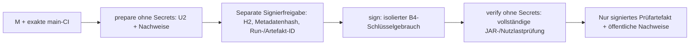

# T-006 – konkreter Plan für den signierten Code18-AAB-Prüfweg

Verbindlich für die weitere Bearbeitung: [Effizient und autonom arbeiten](ARBEITSWEISE.md). UI-Anpassungen gesammelt zum Schluss, nach Funktionslogik und Datenmodell.

## Fortschreibung: Stufe-C-Abbruch im Inputschema lokalisiert (15.11.2026)

[Resolve-Schema-Befund und begrenzter Folgeplan](CODE18_RESOLVE_SCHEMA_BEFUND_T006.md): `INVALID_SCHEMA` betrifft das Eingangsschema in `invocation()` vor den CI-Abfragen. Auch für prepare verlangt der Parser alle fünf optionalen Signierfelder; positive Fixtures decken deren Auslassung nicht ab. Die tatsächliche Eingabeform in P bleibt unbekannt. Heute keine Korrektur, Tests oder Workflowaktion. Den kleinsten belegten lokalen Schemafix separat beauftragen. U2/H2/HP/A/S fehlen; keine Signierfreigabe. M-/W-/Code17-Gates bleiben erhalten.

## Fortschreibung: erster Stufe-C-Aufruf in resolve fehlgeschlagen (14.11.2026)

[Erster prepare-Lauf und Abbruchbeleg](CODE18_PREPARE_NACHKONTROLLE_T006.md): P43637658561 / workflow_dispatch / main / WorkflowW741fb7b / Versuch1 **Failure nach9s**. Resolvefailed im Schritt „Exakte getrennte main-CI für M und W prüfen“,prepare/sign/verifyskipped;keine Artefakte/U2/H2/HP/A/S. Kein U2/H2/HP/ArtefaktA und damit keine konkreteSignierübergabe. StufeB/M-/W-main-CI bleibtbelegt,StufeCnichtabgenommen. Detailfehler muss erst lesend belegt werden,keinFix/Neustart/sign oderalteCode17-Manifesteumdeuten. FrüherePlanungsstände historisch,Hnur lokalsichern und weitereFreigabenoffenhalten.

## Fortschreibung: Stufe B im belegten Umfang abgeschlossen (14.11.2026)

[PR3-Merge und neue exakte main-CI](PR3_MAIN_CI_NACHKONTROLLE.md): PR3Merged, tatsächlichesW `741fb7b09f0a442d779aaed192bd223724d3523f` mit ElternM/L und EntwicklungsheadL erhalten. Neue ci.yml43622275785 / exaktW / push / main / Versuch1 **erfolgreich**. Öffentliche Summary: 1372 Vitest bestanden / 0 Fehler / 0 Skips; 379 Playwright bestanden (9.4m). M/App-CI43601398931 getrennt bestätigt; tatsächlichesW alsWorkflowquelle bekannt,nichtlokalgeholt. Vorherige Formulierungen ohneW beziehen sich auf früherePlanung. StufeC/prepare weiterhin separat freigeben,keinKeygebrauch/sign/Play/Gerätefreigabe. U1nichtU2; konkreteH2/HP/P/Versuch/A nochunbekannt. Gnur lokal.

## Fortschreibung: Stufe A lokal implementiert und offline geprüft (14.11.2026)

Der folgende Plan ist jetzt als [lokaler Workflow-/Prüfhelferentwurf](CODE18_AAB_WORKFLOW_ENTWURF.md) umgesetzt;43gezielteOfflinefälle grün. Keine externeAbfrage/Appbuild/echteSignierung/Workflowausführung oder Übertragung. Ursprüngliche Formulierungen „Datei heute nicht angelegt/Implementierung nicht begonnen“ unten beschreiben den davorliegenden Planungsauftrag. L bleibt lokalerEntwurf,nichtspäteresW;U1unverändert,keineRunner-U2/signedS-Nachweise. Nächster eigenerAuftrag begrenzterEntwicklungsbranch-PushL/automatischeCI-Nachkontrolle erst nachseparaterFreigabe;weitereStufenB–F einschließlichmain/WCI undprepare/sign bleibenoffen.

Stand **14.11.2026, Europe/Berlin**. Nur lokale Quelleninspektion und neue Planungsdokumentation. **Kein implementierter oder ausgeführter Signierweg und keine Signierfreigabe.**

## Gesicherter Ausgang und tatsächliche Lücke

Arbeitsort `/workspace/anker-main-code18-aab`, Branch `entwicklung/anker-neu`, sauberer Ausgangshead **`e3ef74fa4f67fcccb1a59b653771b778e8954c2c`**. [Vorhandener Paketnachweis](MAIN_CODE18_AAB_PRUEFBUILD_T006.md) und lokale JSON-/Logbelege sind verfügbar. Datei heute ausschließlich auf Größe und SHA256 geprüft; keine Paketprüfung, Softwaretests oder Builds wiederholt.

| Identität | Fester vorhandener Nachweis |
|---|---|
| Appquelle M | **`10cc894a27302a5a49b6884c843d2a6b509ab354`** |
| Quellkennung F | **`e9c1249900f449001be6dfb80674a5fe9b2b27af8d2cabf195dba9b2ab654b99`** |
| Lokales unsigned Referenz-AAB U1 | `/workspace/anker-main-code18-aab-pruefung-20261114/Anker-Code18-main-10cc894-UNSIGNIERT.aab` |
| U1-Größe / SHA256 H1 | **54.264.632 Bytes / `74e65b1a1999f7a1b9b19244d9aa5fcf058d025904009d8ca0c08448de050d50`** |
| Paket / Version / SDK | `de.frnkrm.anker.mobile`,18/1.5.0-rc.4,min26/target36/compile36 |
| Quell-CI | Gespeicherter Beleg `ci.yml`,Run43601398931,push/main,M,Success,379Browser/1372Vitest. Letzte externe Bestätigung im vorigen Auftrag14.11.2026um14:03UTC; **heute keine externe Abfrage** |
| Aktuelle Signatur | Vorhandener unveränderter Nachweis:672Einträge,0CodeSigners/Certificates/Signaturdateien. Heute nur dessen Verfügbarkeit/Dateibindung geprüft |

Die Workflowquelle W und ein signiertes Ergebnis S existieren als Nachweis **noch nicht**. Lokale Dokumentationsheads sind weder M noch W. Keine aktuelle Remote-/Secret-/Playverfügbarkeit aus historischen Angaben ableiten. Historisches AAB014870f3 enthält den NFC-Fix nicht und wurde nicht wiederhergestellt; ursprüngliche alte Umgebung/835235b bleibt zurückgestellt.

## Lokaler Codebefund

| Gelesene Definition | Tatsächliche Funktion | Nutzbarer Teil / Grenze |
|---|---|---|
| [android-update.yml](../.github/workflows/android-update.yml) | Manueller main-Dispatch; exakte main/push/ci.yml-Prüfung; getrennte Build-/Signierjobs; `unsigned.apk` und `apksigner` | Quellen-Gate und isolierte Datenübergabe als Muster. **Kein AAB-Signierer.** Leere Quellwahl bindet altes Code17-Manifest; fehlende Secrets können dort unsigned APK liefern, was für neuen Signiermodus nicht genügen darf |
| [android-update-proof.py](../scripts/android-update-proof.py) | Reine Versions-/CI-Prüfung und APK-spezifische Manifest-/ZIP-/Ausrichtungs-/frische JUnit-Prüfung | Versions-/exakte CI-Semantik wiederverwenden. APK-zipalign/apksigner beweisen keine AAB-/JAR-Signatur |
| [sign-local-update.mjs](../scripts/sign-local-update.mjs) | APK-Signierhilfe mit bestehendem lokalem Schlüssel; kennt Debugkeystore-/Alt-APK-Rückwege | Kein AAB-Weg; **nicht ausführen** und keine private Datei dafür suchen. Lokaler passender B4-Keyzugriff wird nicht unterstellt |
| [setup-android-signing.ps1](../scripts/setup-android-signing.ps1) | Liest bestehenden privaten Keystore und überträgt vier GitHub-Secrets | Kein lesender Nachweis. **Nicht ausführen**, keine Secret-Einrichtung für diese Planung |
| [release.yml](../.github/workflows/release.yml) | v*-Tag → signierte APK/GitHub-Release; anderer ANDROID_*-Namensraum | Für diesen begrenzten AAB-Prüfweg ungeeignet; keine Tags/Veröffentlichung |
| [google-play-upload.yml](../.github/workflows/google-play-upload.yml), [Publisher](../scripts/google-play-upload.py) | Alter main-Dispatch oder main-Push mit genauer Workflowdatei/Marker; festes Code17-AAB, Quelle80f6a692, eigene Hash-/Bytes-/CI-Pins | Kein Signierer. Publisher akzeptiert nicht bloß durch ein anderes Manifest Code18. **Unverändert erhalten**, auch Diagnose-/Authpfade nicht starten |
| [PLAY_UPLOAD_APPROVAL.json](PLAY_UPLOAD_APPROVAL.json), [AKTUELLER_UPDATESTAND.json](AKTUELLER_UPDATESTAND.json) | Alte Code17/rc.3/80f6a692/42748341550/B4-Bindung | Historische Freigaben, keine Freigabe für M/U1 oder ein künftiges S; bytegleich erhalten |
| [android/app/build.gradle](../android/app/build.gradle) | Keystoredatei bzw. ANDROID_*-Umgebung kann Gradle-Release-Signierung binden | Build bleibt zwingend ohne Signiersecrets und mit vor Konfiguration prüfendem unsigned Guard; keine Gradle-Signierkonfiguration ändern |

## Gewählter kleinster überprüfbarer Ablauf

Vorgesehen ist **ein neuer, ausschließlich manuell auf main gestarteter Prüfworkflow** mit zwei getrennten Modi `prepare` und `sign`, etwa `.github/workflows/android-aab-pruefstand.yml`. Diese Datei wird heute **nicht angelegt**. Keine Push-/PR-/Tag-/workflow_run-Auslöser und kein Play-/Releasejob.

Das vorhandene U1 liegt nur lokal; ein Runner kann `/workspace/...` nicht lesen. Ein direkter Signierjob für U1 benötigte erst einen separat autorisierten, belegten Transport dieses exakten Binärartefakts. Statt diesen Transport oder einen lokalen privaten Schlüssel zu unterstellen, erstellt `prepare` auf einem secretfreien Runner ein eigenes U2 aus **exakt M**. Wegen Buildumgebung/ZIP-Metadaten ist H2 nicht als gleich H1 garantiert; auch vollständige Nutzlastgleichheit U2↔U1 wird nicht unterstellt. U2 braucht eigene vollständige Paket-/Asset-/Quellnachweise und anschließend eine **eigene ausdrückliche Signierfreigabe für H2**.

Damit ist keine neue Cloud-Environment-Freigabekonfiguration nötig: Die zwei manuellen Aufrufe bilden den Übergabepunkt. Das lokale U1 bleibt unveränderte Referenz und wird weder als Actions-Artefakt ausgegeben noch ersetzt.



### 1. Gemeinsame Quell- und Workflowbindung

Vor jedem späteren Aufruf im dann separat freigegebenen Umfang lesend prüfen:

- Repository exakt `frnkrm/anker`,Event `workflow_dispatch`,Ref `refs/heads/main`; eindeutiger Modus, keine implizite Quellenwahl/Code17-Fallbacks.
- Pflichtangaben `source_commit=M`, `expected_workflow_commit=W`. W ist erst die tatsächlich integrierte und geprüfte Workflow-SHA; lokaler Entwurfscommit L und heutiger Dokumentationshead sind **nicht W**. Lauf muss die tatsächliche `github.workflow_sha` gegen W prüfen; keine Selbst-SHA im selben Commit erfinden.
- M und W müssen in der tatsächlichen main-Historie liegen. Für **M exakt** bleibt erfolgreiches `completed/success`,`event=push`,`head_branch=main`,`head_sha=M`,Workflowpfad `.github/workflows/ci.yml` im richtigen Repository zwingend. Bekannter M-Run43601398931 samt tatsächlichem Versuch erneut prüfen. Keine Docs-Ausnahme oder Ersatz durch Branch-/PR-/W-CI.
- Zusätzlich eigene grüne main-Push-CI für W einschließlich neuer Offline-Sicherheitsprüfungen verlangen. M-CI und W-CI getrennt dokumentieren. Bei roter/fehlender CI, API-403, anderer SHA oder unerfüllter Serveranforderung stoppen, keine Authreparatur/Schutzregelumgehung.

### 2. Modus prepare – neuer unsigned Prüflauf ohne Schlüssel

Nur nach eigener Build-/Workflowstartfreigabe. Vertrauenswürdige Prüfhelfer gehören zu W und werden separat gebunden; eigentliche Appquelle liegt in eigenem Checkout exakt M, ohne gespeicherte Checkout-Zugangsdaten. W-Code darf nicht als Appquelle gebaut werden.

Bestehende Version18/rc.4, Paket/SDK/Berechtigungen/Abhängigkeiten erhalten. Frischen Webbuild/Capacitor-Sync und den belegten Generator-Fingerprint-Stabilisierungsschritt berücksichtigen. Erwartete F muss stimmen, getrackte M-Produktinputs dürfen nicht driften. Vor Gradlekonfiguration auf fehlende Signierdatei/-umgebung prüfen; Null-Signierbindung und signaturfreien `packageReleaseBundle`-Graph erzwingen. Kein `signReleaseBundle`, APK-/Debugbau oder Signierkonfigurationswechsel.

U2 vollständig prüfen wie beim lokalen Nachweis: Bundletool, ZIP-CRC/Struktur/Größenlimits, Manifest/Paket/Version/SDK/Rechte/Backup/NFC, bytegleiche aktuelle Webassets, keine alten Webreste, vollständiger JAR-Lesetest ohne Signierer sowie passende native ELF-Prüfung. Keine fehlende Prüfung durch U1-Hash ersetzen.

Nur Daten hochladen: `unsigned.aab` und streng definiertes `proof.json`, keine Skripte/JAR-Helfer zur späteren Ausführung. Proof enthält M,F,Paket/Version/SDK,Quell-/Workflow-CI,W,Toolversionen,Dateigröße,H2,vollständiges Eintrags-/Payload-Hashinventar und Prüfergebnisse. Ergebnis eindeutig an Prepare-Run **P**, tatsächlichen Versuch und unveränderliche Actions-Artefakt-ID **A** binden. Actions-Archivdigest, innerer AAB-Hash und Metadatenhash sind unterschiedliche Werte.

### 3. Übergabe – genaue Bytes vor privatem Schlüsselgebrauch freigeben

Nach erfolgreichem prepare sind mindestens folgende **öffentliche** Werte konkret reviewbar: W,M,F,P/Versuch,A,Archivdigest,H2,Bytezahl und Metadaten-SHA256 HP. Diese Werte müssen vor dem zweiten Aufruf in dessen eigener Freigabe stehen; heute bleiben sie unbekannt. Keine automatische Signierung im selben Aufruf und kein `latest`/Dateiname-allein als Auswahl.

Vorgesehene Pflichtinputs für `sign`: `source_commit`, `expected_workflow_commit`, `prepare_run_id`, `prepare_run_attempt`, `unsigned_artifact_id`, `expected_unsigned_sha256`, `expected_proof_sha256`. Artefaktbezug und Archivdigest gegen API-/Prepare-Ausgaben binden, nicht gegen frei gewählte Metadaten allein. Andere W-/M-/Versuchsidentität oder neuer U2-Hash benötigt neue Freigabe.

### 4. Modus sign – eigener Runner mit eng begrenztem Schlüsselgebrauch

Nur nach gesonderter **Signier-/einmaliger Dispatchfreigabe für genau diese Übergabe**. Vor Secretmaterialisierung muss ein secretfreier Resolve-/Prüfschritt den Prepare-Lauf mit W/main/workflow_dispatch/Success und richtigem Versuch, die Herkunft der Artefakt-ID A, H2/HP sowie sämtliche Quellen-/Paketnachweise bestätigen. Keine fallweise ältere erfolgreiche Übergabe wählen.

Signierjob nach bestehendem Isolationsmuster: kein Appcheckout, npm, Gradle, Buildcache oder ausführbarer Code aus dem Übergabeartefakt. Nur zum geprüften W gehörender feststehender Workflow-/Prüfcode und versionierte/hashgebundene Werkzeuge. Heruntergeladene Dateien dürfen ausschließlich begrenzte reguläre Datendateien mit erwarteten Namen sein; Symlinks, Zusatzdateien, doppelte JSON-Schlüssel, ungültige Hashes/Größen und unsichere ZIP-Pfade ablehnen. AAB nie als Java-Programm ausführen oder als Code-Classpath laden.

Nur im tatsächlichen Signierschritt diese bestehenden Namen referenzieren:

- `ANKER_ANDROID_KEYSTORE_BASE64`
- `ANKER_ANDROID_STORE_PASSWORD`
- `ANKER_ANDROID_KEY_ALIAS`
- `ANKER_ANDROID_KEY_PASSWORD`

Bestand/Scope/Inhalt sind **unbestätigt**. Keine neue Secret-/Environmenteinrichtung und keine Ausweichnamen; Environment-Secrets ohne gebundenes Environment nicht als verfügbar voraussetzen. Sind Werte für diesen Lauf nicht vollständig verfügbar, abbrechen, **kein unsigned Fallback als Signiererfolg**. Das beweist keine allgemeine Abwesenheit im Repository.

Nur künftig autorisiert: vorhandenen Keystore kurzlebig im Runner-Tempverzeichnis mit privaten Dateirechten materialisieren, ausschließlich angegebenen bestehenden Alias verwenden, dessen öffentliches Zertifikat gegen festes **B4** prüfen. Kein neuer Schlüssel, keine Aliassuche oder Schlüsselrotation. Bei falschem Zertifikat/Passwort/Format vor Signierung stoppen. Passwörter nur über gezielte Prozessumgebung/geschützte Eingabe, niemals CLI-Klartext/Logs/Step-Ausgaben; private Prozessausgaben nicht öffentlich durchreichen. Kein Shelltrace, keine Keystore-/Secretartefakte oder Cacheaufnahme. Auf Erfolg/Fehler Keydateien/Secretpuffer im finally-Pfad beseitigen.

AAB mit JDK-JAR-Signierverfahren, etwa `jarsigner`, **in eine neue Ausgabedatei S** signieren. U2 bleibt unverändert. SHA-256 bzw. passende starke Signaturalgorithmen für den tatsächlich bestätigten B4-Schlüssel, keine schwachen Fallbacks oder neuen Online-TSA-Abfragen. `apksigner`/APK-zipalign und bloßes Umbenennen erzeugen keine gültige AAB-Signatur.

### 5. Verify ohne Secrets – erst dann Erfolg ausgeben

Separater Job ohne private Werte: S,U2 und streng gebundene öffentliche Metadaten aus genau diesem Signierversuch prüfen; bis dahin nur kurzlebige interne Übergabe, kein als erfolgreich etikettiertes Downloadpaket.

- Jeden nicht zum Signaturcontainer gehörenden JAR-Eintrag vollständig lesen. Für **jeden Nutzlasteintrag** gültige kryptografische Verifikation und genau einen erwarteten CodeSigner verlangen; dessen Endzertifikat-SHA256 exakt B4. Fehlende/zusätzliche/falsche Signierer und ungesicherte nachträgliche Einträge ablehnen.
- Explizite Whitelist neu erlaubter Signaturmetadaten (`META-INF/MANIFEST.MF`,zugehörige `.SF` und zulässiger Signaturblock). Alle übrigen Eintragsnamen und **uncompressed Bytes U2↔S exakt gleich**; Manifest/resources/DEX/Libs/Webassets sind Nutzlast. Kein breites Ignorieren sämtlicher META-INF-Dateien.
- JAR-Struktur/CRC und Bundletool erneut auf S prüfen; tatsächliche Paket-/Version-/SDK-/Asset-/F-Bindung unverändert. HS und signierte Bytezahl separat berechnen; nicht H2 oder H1 als HS übernehmen.
- Bei zusätzlicher `jarsigner -verify -strict`-Kontrolle Androids typisches selbstsigniertes Zertifikat korrekt behandeln: ausschließlich öffentliches, zuvor gegen B4 gepinntes Zertifikat in einem **temporären Verifikations-Truststore ohne private Schlüssel** nutzen, keine globale Truststoreänderung. Keine pauschale Unterdrückung von Chain-/Algorithmus-/unsigned-entry-Fehlern. Kein externer Zertifikats-/TSA-Zugriff.
- Erst nach allen Prüfungen finalen signierten AAB-Prüfdownload mit öffentlichen Nachweisen bereitstellen. Rechte möglichst `contents:read`/`actions:read`,kein contents:write/Google-OAuth/id-token für Signierweg. Run-ID/Versuch/Artefakt-IDs eindeutig; keine automatischen Reruns/Signierwiederholungen bei unklarem Ergebnis.

## Öffentliche Bindung des späteren Ergebnisses – nur Schema im Dokument

Heute kein neues Freigabemanifest anlegen. Der spätere **Prüfnachweis**, getrennt von einer Uploadfreigabe, muss mindestens enthalten:

| Feldgruppe | Bindung |
|---|---|
| App | M,F,applicationId,Code18/rc.4,SDK,Quell-CI-Run/Versuch |
| Workflow | W,Workflowpfad,Workflow-CI-Run/Versuch,manuelle Modi/Events/main |
| Referenz | U1,H1,54.264.632Bytes,Belegpfad; ausdrücklich lokaler Vorprüfstand |
| Tatsächlicher Signiereingang | U2,H2,Bytes,HP,Prepare-P/Versuch,Artefakt-ID A und Archivdigest |
| Signierausgang | S,HS,signierte Bytes,B4-Fingerabdruck,Algorithmen,Signier-/Verify-Run/Versuch,finale Artefakt-ID |
| Grenzen | unsignedReferenz ersetzt keine signedBytes; `uploadedToPlay=false`,`deviceVerified=false`,keine Gesamtfreigabe |

## Zertifikatsrollen und offene Nachweise

Erwarteter Uploadsignierer **B4** laut bereits zugeordneten öffentlichen Belegen:
`B4:7F:FF:FE:BE:13:7C:F1:51:29:96:1D:E4:3A:27:E3:EC:81:1A:CF:FE:45:42:B6:32:4E:11:76:89:95:B1:3A`.

Gemeldeter **Play-App-Signierer8A**:
`8A:32:E7:B7:7E:ED:CD:88:47:7B:74:0F:EF:2B:58:36:F5:5A:5C:CB:22:C7:35:F2:0E:32:2A:A9:05:30:44:29`.

B4 ist die Uploadrolle, 8A die gemeldete Rolle ausgelieferter Play-APKs. Ein korrekt B4-signiertes AAB ist keine direkt installierbare APK und kein Beleg einer Geräteaktualisierung. Keine Schlüssel-/Signierfähigkeit aus Namen/Fingerabdrücken oder Besitzerbericht ableiten. Keine bekannte Besitzer-/Paket-/Play-/Zertifikats-/Secretfrage erneut stellen, keine privaten Pfade/Dateien/Passwörter verlangen.

Nicht belegt: tatsächlich zugängliche passende Runner-Secrets, W und dessen main-CI, Prepare-P/U2/H2/HP/A,signiertesS/HS,B4-Prüfergebnis,neue Play-Uploadzulässigkeit/Code18-Verfügbarkeit und echte Gerätetests. Unbekannt bleibt unbekannt; für die lokale Entwurfsimplementierung ist keine erneute externe Metadatenrunde nötig. Spätere Runnerprüfungen müssen fehlende Rechte/Secretverfügbarkeit konkret fail-closed melden, keine Auth-/Cloudreparatur starten.

## Kleinste getrennte Freigaben und Abbruchbedingungen

| Stufe | Kleinster nächster Umfang | Noch ausdrücklich nicht enthalten |
|---|---|---|
| A – lokale Implementierung | Neuer manueller Zwei-Modus-Workflow,neue AAB-/Handoff-Prüfhelfer,gezielte Offline-Regressionsfälle und deren CI-Einbindung als lokaler Entwurf | Externe Abfrage/Übertragung,Workflowstart,Appbuild,echte Signierung,private Werte |
| B – normale GitHub-Integration | Erst nach Review/Tests begrenzter Branch-Push/PR und reguläre main-Integration der Automation; genaue W bestimmen,eigene main-CI W prüfen | Keine automatische Dispatch-/Signierfreigabe. M bleibt getrennte Quelle. Gegebenenfalls bestehende main-Webautomatik vor Integration einschließen |
| C – einmal prepare | Expliziter manueller secretfreier M-Build/Prüflauf mit öffentlicher Dependency-/Actions-Artefaktübertragung; U2,H2,HP,P/A vorlegen | Noch kein Keygebrauch,kein signierter Output,kein Play |
| D – einmal sign/verify | Erst separat für konkrete H2/HP/P/A/W/M autorisierter vorhandener B4-Keygebrauch im isolierten Runner und signierter Actions-Prüfdownload | Keine Secretänderung,Schlüsselsicherung/-rotation,Installation,Upload oder Release |
| E – späterer interner Playweg | Erst nach gültigem S eigene Code18-spezifische neue Uploadbindung/Guardvorlage,aktuelle zulässige Versions-/Bestandsprüfung und gesonderte Uploadfreigabe | Alte Code17-Manifeste/Publisher/Guards nicht umschreiben;kein öffentlicher Rollout oder automatische Aktivierung |
| F – Geräte/Gesamt | Separate reale Galaxy-/Windows-/Kalender-/NFC-Beobachtungen an bestehenden Stationen | Signatur-/CI-/Paketprüfung hakt E-002–E-005/T-006-Gesamtfreigabe nicht ab |

Für A jetzt kleinste Handlung: lokale Entwurfsimplementierung separat beauftragen. Kein weiterer Signier-/Secretzugriff nötig, keine wiederholten Nutzerfragen. Für C/D sind die späteren konkreten Lauf-/Artefaktwerte und Freigaben Voraussetzung. Fehlender/abweichender Quell-/Workflow-/CI-/Artefakt-/Hash-/Zertifikatsbeleg, unvollständige Secretverfügbarkeit oder unsicherer Signierweg bedeutet **vor Schlüsselgebrauch bzw. vor Erfolg stoppen**; kein unsigniertes Ersatzpaket,keine Gates lockern/Tests überspringen,kein Reparaturupload.

Für den reinen Signier-Prüfweg keine Play-Abfrage als zusätzliche Voraussetzung erfinden. Code18 ist dadurch nicht reserviert oder als aktuell frei bestätigt; diese Prüfung gehört erst zur später separat autorisierten Uploadentscheidung. Neue Uploadwerkzeuge dürften erst dann separat entstehen; bloßes Ersetzen von JSON-Quellwerten ist beim fest verdrahteten Code17-Publisher technisch unwirksam und nicht erlaubt.

## Gezielte spätere Prüfungen und heutiger Abschluss

Stufe A: pure/mocked Offlinefälle für M/W/main-CI-Verwechslung,alte/andere Versuche und Artefakt-IDs,Archiv- vs. AABhash,fehlende/vertauschte Metadaten,ZIP/Symlink/Größen-/Duplicate-Key-Eingaben,U2/S-Nutzlaständerung,unsigned/zusätzliche/falscheSignierer,keine Secrets im prepare,kein unsigned Fallback im sign,keine Push-/PR-/Tag-/Playauslöser und Geheimnisausgaben. Vorhandene Syntax-/Workflowprüfer nutzen; fehlende Werkzeuge benennen,keine unbegründete Installation. Mocks sind keine echte kryptografische Signierprobe. Keine Produktionsschlüssel oder AAB-Signierung im lokalen Entwurf; vorhandene Produktvollsuiten ohne Integrationsgrund erhalten.

Heute nur lokale Lese-/Planungsarbeit und Dokument-/Quell-/Altbestand-/Bundle-/SHA256-Integrität. Keine externe Abfrage,Secretnamens-/Wertprüfung,Schlüsselsuche,Build/Tests,Signierung,Workflow-/Freigabemanifest-/Cloudänderung oder GitHub-/Play-/Geräteaktion. Alte Arbeitsbäume/Sicherungen/U1/Code17-Dateien unverändert. Sicherung `/workspace/anker-t006-code18-aab-signierplan-20261114/` mit Quellinventar,öffentlichen vorhandenen Referenzbelegen,Dokumentation,Gitbundles/Restore/Hashes,keiner neuen Paket-/Schlüssel-/Secretkopie;nur Cloud-lokal.

**Planung abgeschlossen, Implementierung nicht begonnen. T-006/V-014 IN_ARBEIT;E-002–E-005 und Signier-/Upload-/Geräte-/Gesamtfreigaben offen.** Genau nächster separat zu beauftragender Einzelauftrag ist Stufe A: lokalen manuellen Code18-AAB-Workflow-/Prüfhelferentwurf samt Offline-Regressionsprüfungen erstellen,ohne externe Abfrage/Appbuild/Signierung/Workflowstart/Übertragung. Danach stoppen.


## Letzter Arbeitspunkt: Weckzeit-Fix vor dem endgültigen Code18-Update

Der Nutzerauftrag gilt vollständig. Der gemeldete ältere uncommittete Diff ist hier nicht vorhanden; eine gezielte Umsetzung auf aktueller Basis ist lokal geprüft, genaue Quelle/CI/Integration bleiben im autonomen Fortschrittsbericht getrennt. Erst nach erfolgreicher regulärer Integration und exakten main-CI-/Policygates neue endgültige Artefakte erzeugen. Historisches M/P5 genügt nicht. Code18-Playbestand unbekannt, Konflikt bei verbrauchtemCode18 melden, kein stillerCode19.

Vollständiger ursprünglicher Übergabeauftrag unverändert:

```text
Bitte nimm den bereits lokal umgesetzten Weckzeit-Bugfix in den laufenden Git-/Play-Releaseweg von frnkrm/anker auf. Arbeite mit minimalen Änderungen und erhalte deine bisherigen Releasearbeiten.

Problem und gewünschtes Verhalten:
- Standard-Weckanker: 08:10 Uhr.
- Tages-Override für 11.11.: 06:05 Uhr (wakeOverride: 365).
- Der Override hat absichtlich Vorrang. Damit ist das 45-Minuten-Smart-Wake-Fenster 05:20–06:05 korrekt.
- Die Priorität war jedoch unzureichend sichtbar. Nach bewusstem Entfernen des Overrides sollen wieder 08:10 und 07:25–08:10 gelten.
- Standardänderungen dürfen Tages-Overrides nicht automatisch löschen.

Vorhandener lokaler Fix:
Arbeitsbaum: /workspace/anker
Branch: entwicklung/anker-neu
Basis-HEAD: 4f3179c36afaa3408a1a57fc26d4a5a458c516bf
Die Änderungen sind noch NICHT committed, gepusht oder veröffentlicht. Dieser Arbeitsbaum ist älter als der aktuelle main-Stand. Nicht zurücksetzen oder ungeprüft vollständig übernehmen.

Geänderte Dateien:
- src/core/alarm.ts
- src/core/alarm.test.ts
- src/platform/wakeChange.test.ts
- src/ui/components/SmartWake.tsx
- src/ui/components/WakeSuggestion.tsx
- src/ui/pages/Alarm.tsx
- src/ui/pages/Settings.tsx
- docs/ANKER_IMPLEMENTIERUNGSPLAN.md
- docs/ANKER_TESTNACHWEISE.md

Neue, noch unversionierte Dateien:
- src/ui/components/NextWake.tsx
- e2e/wake-priority.spec.ts

Umsetzung:
- Bestehende Prioritätsregel in TypeScript und Kotlin war bereits korrekt: Tages-Override vor Standardanker.
- nextWakeDetails() verwendet die bestehende nextAlarmTimes()-Berechnung und liefert Termin, Datum, Minuten und aktive Überschreibung.
- Gemeinsame Anzeige der nächsten wirksamen Weckzeit unter „Schlaf & Anker“ und beim Wecker; Einstellungsübersicht zeigt ebenfalls die effektive nächste Zeit.
- Aktive Tagesüberschreibung mit ausdrücklichem Prioritätshinweis.
- Direkter Zugang zum bewussten Ändern oder Entfernen über den vorhandenen WakeSuggestion-/applyWakeChange-Weg.
- Zeiteingabe allein speichert nichts; ungültige Eingaben deaktivieren den Speichern-Knopf.
- Smart-Wake-Vorschau verwendet die aktuelle Konfiguration statt eines möglicherweise veralteten alarmStatus.scheduledAt.
- Hinweis, wenn eine noch gemeldete aktive Messung zu einem anderen Zieltermin gehört.
- Bestehender Store-Writer, Neuplanung und native Alarmarchitektur bleiben erhalten. Keine Kotlin-/Brücken-/Versions-/Releaseänderungen durch diesen Fix.
- Nach Änderung des Messziels bleibt ein bewusster Neustart der Messung erforderlich.

Bisherige Prüfungen auf dieser lokalen Basis:
- 37/37 Vitest-Fälle erfolgreich:
  npm test -- src/core/alarm.test.ts src/core/smartWake.test.ts src/platform/alarm.test.ts src/platform/wakeChange.test.ts
- 5/5 Browserfälle erfolgreich:
  e2e/wake-priority.spec.ts
  e2e/travel-sleep.spec.ts
- Neuer Browserfall nach zusätzlicher Eingabevalidierung nochmals erfolgreich.
- Typecheck und Produktionsbuild erfolgreich.
- Lint: keine Fehler, eine bestehende fremde Warnung in TaskAssistance.tsx.
- git diff --check erfolgreich.
- Kein echter Android-Hörbarkeits-/Sensor-/Standby-Test.

Regressionen umfassen:
mit/ohne Override, Änderung des Standardankers bei erhaltenem Override, bewusstes Ändern/Entfernen, native Konfigurationsübertragung, gemeinsamer Haupt-/Vorwecker, 45-Minuten-Fenster, Reload und Erhalt echter Tageserledigungen.

Bitte jetzt:
1. Prüfe deinen aktuellen Git-/Release-/Play-Stand und laufende Arbeiten frisch.
2. Sichere und lies den lokalen Diff einschließlich beider unversionierter Dateien. Falls der Arbeitsbaum in deiner Umgebung fehlt, melde das ausdrücklich; der Fix ist noch nicht über GitHub verfügbar.
3. Übertrage nur diesen Fix auf die aktuelle passende Basis, möglichst in einem isolierten Arbeitsbaum und eigenen kleinen Commit/PR. Bestehende Releasearbeiten und neuere Dokumentation erhalten; Dokumentationseinträge inhaltlich abgleichen.
4. Führe die gezielten Regressionstests und die erforderlichen Integrationsprüfungen erneut aus.
5. Nimm den geprüften Fix über den bestehenden Git-/AAB-/Play-Prozess in das nächste interne Update auf, innerhalb bereits erteilter Freigaben.

Zuletzt extern geprüft:
- main war 860b0ca639b2271b357fd404df626c22ef30b29f.
- README meldet Code17 seit 15.11.2026 intern verfügbar und eine bestätigte Play-Installation.
- Code18-Prepare 43758395655 erfolgreich, Artefakt:
  anker-code18-unsigned-43758395655-1
  sign/verify übersprungen.
- Letzter geprüfter Code18-Lauf 43773427542 vom 16.11.2026, 00:11 Uhr Europe/Berlin:
  resolve fehlgeschlagen bei „Exakte getrennte main-CI für M und W prüfen“; prepare/sign/verify übersprungen.
- Das sind Beobachtungen, keine aktuelle Play-Bestandsbestätigung. Deinen neueren Stand berücksichtigen.

Versionsregel:
Ein bereits bei Play verwendeter versionCode kann nicht für ein verändertes Bundle wiederverwendet werden. Vor Auswahl der nächsten Nummer den tatsächlichen Play-Bestand prüfen; Code19 nicht ungeprüft festlegen. App-Kennung und vorhandenen Signierweg erhalten. Keine Direkt-APK als Ersatz für das Play-Update, keine Deinstallation/Datenlöschung und keine öffentliche Produktionsfreigabe aus diesem Auftrag ableiten.

Berichte abschließend kurz: integrierter Commit/PR, Testergebnis, gewählter versionCode, tatsächlicher Play-Status und ob der Fix schon per Play aktualisierbar ist.
```
