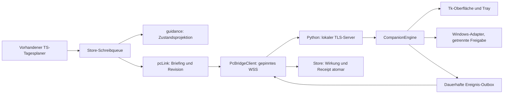

# Anker-Link v3: Architektur und Datenvertrag

Der ausführbare Serververtrag steht in [`pc-companion/PROTOCOL.md`](../pc-companion/PROTOCOL.md). Diese Übersicht erklärt die Vertrauensgrenzen und verweist auf die konkreten Module. Bei einer Drahtänderung werden TypeScript, Kotlin, Python, Fixtures und Tests gemeinsam angepasst.

## Ein Plan, zwei Ausführungsorte

`src/core/guidance/` projiziert den bestehenden Plan, bestätigte Routinen und lokale Tatsachen auf benannte Phasen. Es berechnet keinen zweiten Tagesplan. `src/core/pcLink/` validiert Briefings, Zustände, Empfang und Ereignisse. `AlarmController` bleibt der alleinige Besitzer echter Android-Wecker. Ein PC-Ereignis, Countdown oder Ablauf setzt keine Routine auf erledigt.

## Verbindung und Kopplung

- Lokaler TLS-Server: TCP **47830**, mDNS **`_anker._tcp.local.`**.
- Android überträgt Daten über **WSS `/v3/ws?pair=<id>`** mit begrenztem Wiederverbinden. REST wird für Kopplung/Status verwendet; `/health` und `/v3/hello` sind wirkungsfrei.
- Der Server unterstützt zusätzlich verschlüsseltes **POST `/v3/link`** für kompatible Clients. Die Android-Implementierung verwendet diesen Endpunkt nicht als automatischen Daten-Fallback.
- Der einmalige, höchstens zehn Minuten gültige QR trägt lokale Adressen, öffentlichen ECDH-Schlüssel, Zertifikats-Pin und ein zufälliges Kopplungsgeheimnis. Deshalb darf ein noch gültiger QR nicht in öffentliche Bilder oder Logs.
- Nach ECDH-P256 und HKDF-SHA256 existieren getrennte AES-256-GCM-Schlüssel für beide Richtungen. Ein HMAC bindet die Kopplungsanfrage. Derselbe vierstellige Code wird auf beiden Geräten angezeigt; erst die ausdrückliche PC-Bestätigung aktiviert die Verbindung.
- Android akzeptiert nur den beim Koppeln festgehaltenen SHA-256-Pin des Blattzertifikats und geeignete lokale Adressen. Kein HTTP-/Systemtrust-Rückfall und keine globale Klartextfreigabe.

## Umschlag und Wiederholungsschutz

Der verschlüsselte JSON-Umschlag hat genau `v`, `kind`, `pair`, `from`, `seq`, `sentAt`, `nonce`, `ct`. Die ersten sechs Felder werden kanonisch als AAD gebunden. Richtung, Paar, Tag, Größen und Zeitgültigkeit werden geprüft. Sequenzen steigen dauerhaft je Richtung, bevor eine Wirkung oder ausgehende Nachricht zugelassen wird. Alte Sequenzen und veränderte Umschläge werden abgelehnt. Maximal 64 KiB je Umschlag, maximal 500 Zeichen je Freitext.

| Nutzlast | Zweck und Bestätigung |
|---|---|
| `state` | Aktuelle Zustandsprojektion mit stabiler Nacht-Session, Planrevision, zeitlicher Gültigkeit, generischem Schrittindex und Wirkungswahl |
| `briefing` | Bis zu 14 bekannte Tagesaufträge; keine erfundenen Zeiten bei offenem Ende |
| `ack` | Bestätigt Revision, Empfangszeit und den tatsächlich wirksamen PC-Stand; erst passender heutiger ACK ist „Plan bestätigt“ |
| `command` | Bewusstes Testen, Aussetzen, Fortsetzen, freie Verlängerung oder bestätigte Hardware-Notverlängerung |
| `pull` / `events` | Dauerhafte Rückmeldungen und Notizen; mindestens einmal geliefert, anhand ID/Sequenz idempotent übernommen |

Die Planzeit kommt vom Handy. `date` ist der Berliner Plantag mit Wechsel um 04:00. Eine begrenzte Nacht-Session kann diesen Wechsel überschreiten, ohne zur nächsten unbegrenzten Nacht zu werden. `validUntil` und `morningDeadlineAt` begrenzen Offlinewirkung und Wieder-Sperrwächter; große Uhrabweichungen verhindern Systemwirkungen. Details und Grenzwerte sind im Serververtrag verbindlich.

Beim freiwilligen Relay ist ein alter Mailboxumschlag kein frischer Handykontakt. Die 90-Sekunden-Grenze gilt für dessen authentifiziertes `sentAt`; Zustandsübernahme und dauerhafte Rückmeldungen bleiben vom aktuellen Kontakt getrennt. Ein abgelaufener gewöhnlicher Bedienbefehl erhält ein negatives dauerhaftes Receipt und ein `ack` mit `command-expired`, ohne `commandId` und ohne Wirkung. Die App darf ihn nicht als bestätigt melden; derselbe alte Befehlsbezeichner wird auch bei erneutem Transport nicht später ausgeführt.

`prefs.bedtimeSequence` ist ein optionaler boolescher Wert: Er wird nur aus der ausdrücklich gewählten Abendbegleitung abgeleitet und nicht als zweite lokale PC-Planung gespeichert. `true` bindet die Folge an `bedAt`; fehlend/`false` erhält `pcStopAt`. Beide Modi verschieben die gelieferten T30-/T10-Abstände vollständig mit einer Verlängerung. Ein `extended`-Ereignis kann seinen Bezug mit `anchor: "bed"` oder `"pc-stop"` nennen; ohne Feld bleibt die alte PC-Stopp-Semantik. Der Store projiziert einen verlängerten Betttermin mit dem vorhandenen Planer und dessen Bildschirm-aus-Puffer, statt ihn doppelt aufzuschlagen.

Ein authentifizierter ACK nennt `effective.stopAt` auch im beobachteten Zustand `locked`. Damit kann die Native-Brücke nach 04 Uhr die ursprüngliche PC-Grenze prüfen, während der aktuelle Handyplan bereits einen neuen Abend zeigt. Die QR-Token-Prüfung verlangt weiterhin Paar, Zustimmung, frischen passenden ACK bzw. bestehenden Nachtbeleg und eine endliche gültige Frist; der ACK allein ersetzt keinen QR-Scan.

Freitextgrenzen zählen wie Android/JavaScript **UTF-16-Codeeinheiten**. Ein Emoji bleibt bei der begrenzten Übertragung ganz; der gespeicherte Originaltext wird nicht verändert. Authentifizierte WSS-Verbindungen oder tatsächlich frische authentifizierte Relayframes verlängern die 90-Sekunden-Kontaktfrist. `link-stale` benennt einen fehlenden aktuellen Kontakt; Offlinepause und expliziter Tagesvorrat bleiben unterschiedliche Entscheidungen. Bereits freigegebene strenge Nächte behalten ihre feste Obergrenze.

Bei einer automatisch aus dem bestätigten Zeitfenster begonnenen Nacht kennt das Handy zunächst noch keine Bett-QR-Session. Nur derselbe gekoppelte Teilnehmer und der exakt zugehörige tatsächliche Morgen dürfen diese Sitzung abschließen. Ein späterer echter Bett-QR derselben Nacht kann deren Identität übernehmen, erhält aber die ursprüngliche Frist und Freigaben. Hardwarebestätigte Nächte verlangen anschließend wieder genau ihre Session-ID; fremde Tage, Teilnehmer oder Sessions geben sie nicht frei.

## Strenger Modus und Ausstieg

Systemwirkungen benötigen gültigen Auftrag, passende lokale PC-Freigabe und die Handywahl. Eine alte Aufgabe **Anker PC-Stopp** verhindert neue Systemwirkungen. Vor Sperren, Ruhezustand oder Herunterfahren läuft eine eigene Speicherfrist von mindestens 60 Sekunden. Nach Neustart/Wiederaufwachen wird sie neu begonnen.

Der strenge Modus braucht eine zusätzliche Einwilligung. Ein `EMERGENCY_EXTENSION`-Token ist an Paar, Session, Tag, Zielzeit und einmalige Nonce gebunden, kurz gültig und per nicht exportierbarem Handy-Schlüssel signiert. Die Native-Brücke stellt es erst nach bestätigtem QR-Hardwareweg aus. Der PC kann weder eigene Tokens ausstellen noch Windows fernentsperren. Beenden des Begleiters bleibt möglich. Ein echter Morgenabschluss hebt nur die erneute Sperranforderung auf.

## Speicherung und Datensparsamkeit

| Ort | Inhalt |
|---|---|
| Vorhandenes Handy-Repository | Pläne, lokale Fakten, Notizen, Ereignis-Receipts und Cursor über dieselbe Schreibqueue |
| Android-Keystore / geschützter Bridge-Speicher | Kopplungsschlüssel, Sequenzen und ECDSA-Identität; kein JSON-Backup, Sync oder JavaScript-Geheimnis |
| `%LOCALAPPDATA%\AnkerPcCompanion\companion.state` | Atomarer DPAPI-geschützter Zustand, bestätigte Aufträge und Outbox |
| PC-Zertifikatsdatei | Nur öffentliches Zertifikat; privates Schlüsselmaterial dauerhaft im DPAPI-geschützten Zustand |

Standardnachrichten enthalten Zeiten, Zustände und Schrittindex/-anzahl. Private Schritttitel bleiben auf dem Handy. Brain-Dump und Wenn-dann-Satz sind gesonderte Inhaltsfreigaben. Weder QR-Geheimnisse, Schlüssel noch vollständige Freitext-Nutzlasten gehören in Logs. Ein erneuter Sync oder Backup-Import darf keine Kopplungsidentität wiederherstellen.

Auf dem Handy werden PC-Ereigniswirkung und Receipt gemeinsam gespeichert. Erst nach erfolgreichem Commit wird der Cursor bestätigt. Verspätete Ereignisse verändern keine neueren Nutzerentscheidungen. `pc-rest` ist eine Beobachtung mit Quelle, keine erfundene persönliche Handlung; Routinen, Arbeitszeit und Einnahmen werden dadurch nicht pauschal erledigt.

## Prüfgrenzen

Gemeinsame Krypto-Fixtures, manipulierte Umschläge, Replay, Pin-/Adressmodelle, atomare Fehler und Windows-Effekte mit injizierten Grenzen sind automatisch prüfbar. Eine echte TLS/WSS-Schleife auf Linux bestätigt den Netzwerkvertrag, keine Windows-Oberfläche oder Android-Standby-Zustellung. Installations-, Mehrmonitor-, Audio-, Vollbild-, Schlaf-/Aufwach- und Handytests bleiben separate Beobachtungen. Ergebnis und Quellbezug stehen in [Testnachweise](ANKER_TESTNACHWEISE.md#v7--audit-baseline-und-gemeinsame-regression).
