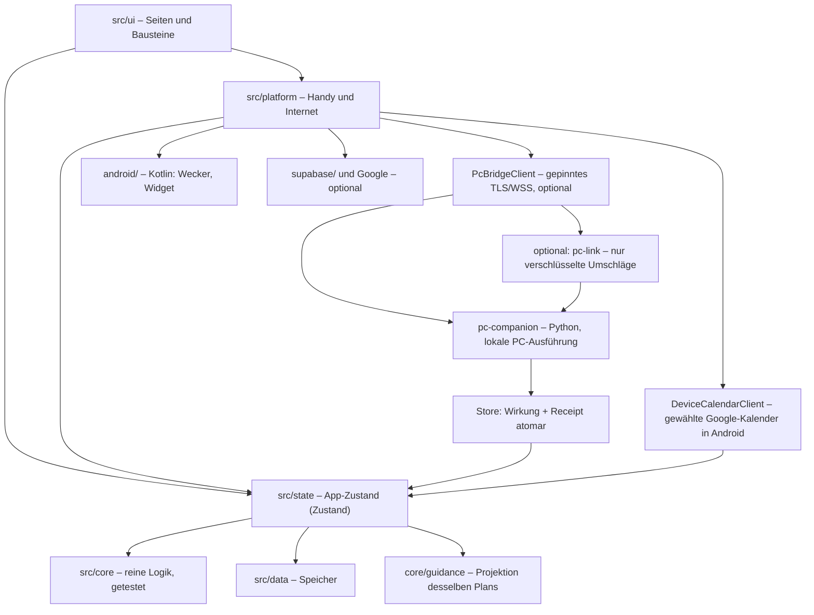

# Struktur des Repositorys

Wo liegt was, und wo änderst du was? Die Bedienung der App steht in [ANLEITUNG.md](ANLEITUNG.md), die Einrichtung der Dienste im [README](../README.md).

**v7: Abend, Morgen und PC-Begleiter.** Es gibt weiterhin einen Tagesplaner, eine Store-Schreibqueue und den bestehenden Android-Weckerbesitzer. Die neue Zustandsprojektion und PC-Ausführung werden daran angeschlossen. Implementierung, automatische Tests und echte Android-/Windows-Beobachtungen stehen getrennt im [Implementierungsplan](ANKER_IMPLEMENTIERUNGSPLAN.md) und den [Testnachweisen](ANKER_TESTNACHWEISE.md).

## Der Grundgedanke

Anker besteht aus wenigen klar getrennten Schichten. Die Pfeile zeigen, wer wen benutzt:



**Was bei einem Tipp passiert:**

1. Du tippst „Erledigt“, die Seite ruft eine Aktion im Store auf.
2. Der Store prüft und speichert lokal; XP entstehen nur aus einer dafür vorgesehenen echten Erledigung, nicht aus Vorschlägen, Überspringen oder Testberichten.
3. `onPlanChange` meldet die Änderung (400 ms verzögert).
4. `platform/effects.ts` plant Erinnerungen und Wecker neu und aktualisiert das Widget.
5. Falls eingerichtet: Sync höchstens jede Minute, Kalender alle 15 Minuten.

## Oberste Ebene

| Pfad | Inhalt |
|---|---|
| `src/` | Der App-Code (Web und Android teilen ihn sich) |
| `android/` | Android-Projekt von Capacitor plus eigener Kotlin-Code |
| `supabase/` | RLS-/Budgetmigrationen sowie getrennte Functions `pc-stop`, `assistant` und optional `pc-link` |
| `pc-companion/` | Lokaler Python-Windows-Begleiter: TLS/WSS, mDNS, verschlüsselter Zustand, Tk/Tray und getrennte Windows-Adapter |
| `e2e/` | Playwright-Prüfungen gegen Produktionsbuilds; kontrollierte Backendantworten ausschließlich in Testhelfern |
| `scripts/` | `icons.mjs` (Icons erzeugen), `gradle.mjs` (Gradle unter Windows und Linux starten) |
| `public/` | App-Icons für die Web-Version |
| `docs/` | Diese Dokumente |
| `.github/workflows/` | `ci.yml` (jeder Push), `release.yml` (signierte APK bei Tag `v*`) |
| `README.md` | Einrichtung: GitHub, Supabase, Google, Netlify, Keystore, Handy, PC |
| `CLAUDE.md` | Architektur und Regeln für spätere Claude-Sessions |

Konfiguration: `app.config.ts` (Paketname), `capacitor.config.ts`, `vite.config.ts`, `netlify.toml`, `.env.example` (alle Variablen, alle optional).

### Ergänzungen in Code17 / PC0.1.1

`platform/deviceCalendar.ts` und `DeviceCalendarConnection` verwenden `DeviceCalendarClient/Model` nach Android-Lesefreigabe. Konto-gebundene Auswahl liegt nur in lokalen Extras; Kalendercache und Termine verwenden die vorhandene Storequeue und denselben Planer. `calendarSource.ts` verhindert, dass verspätete OAuth-/Geräteantworten die neu gewählte Quelle überschreiben. Auswahl wird weder synchronisiert noch auf andere Geräte wiederhergestellt; READ_CALENDAR wird angefordert, WRITE_CALENDAR nicht.

Im PC-Begleiter trennen `widgets.py` und `tray.py` gerundete Tk-Elemente und Windows-Erinnerungsklicks. `desktop_settings.py` validiert Namen, Darstellung und reservierbare Kürzel. Der vorhandene DPAPI-Store bleibt alleiniger Besitzer der Daten. Ein manueller Abgleich wartet auf eine neue authentifizierte Handyantwort; Kontakt oder Senden erzeugt keine Planbestätigung.

Der optionale `relay.py`-Transport verwendet dieselben v3-Schlüssel, Sequenzen, Payloads und die bestehende Empfangstransaktion. Wirkung, Empfangssequenz und verschlüsselte Antwort werden gemeinsam dauerhaft gespeichert, bevor eine Antwort hochgeladen wird. Die Edge-Function kennt nur Umschläge; SQL bindet Owner, Richtung, Token, Sequenz und Ablauf. LAN hat Vorrang. Kein zweiter Tagesplaner und keine zweite unverschlüsselte Befehlswarteschlange.

`updater.py` und der installierte `update-helper.ps1` bilden einen gesonderten signierten Updateweg. Eine feste Kanaladresse liefert zeitlich begrenzte, mit dem bestehenden B4-Zertifikat prüfbare Metadaten; Download ist an einen unveränderlichen Git-Commit und alle Paketbytes gebunden. Bereits installierter Verifier prüft den Stage vor Übergabe und nach dem normalen Prozessende nochmals. DPAPI-Zustand liegt außerhalb von `app`; automatische Prüfungen beginnen aus, Download und Installation bleiben eigene Entscheidungen. Kein Windows-Dienst, kein gekaufter EXE-Signierschlüssel.

Nicht im Repo, weil von `.gitignore` ausgeschlossen: `node_modules/`, `dist/`, `.env`, `android/app/build/`, Keystore und `keystore.properties`.

## `src/core/` – die Logik

Reine Funktionen ohne Seiteneffekte. Hier liegen auch die meisten Tests.

| Datei | Aufgabe |
|---|---|
| `time.ts` | Zeitrechnung für Europe/Berlin inklusive Sommerzeit |
| `types.ts` | Alle Datentypen (`Settings`, `DayLog`, `DayPlan` …) |
| `defaults.ts` | Standardwerte und Zeitvorschlag, rückwärts vom Arbeitsbeginn |
| `now.ts` | Was der Tagesplan gerade vorsieht |
| `support.ts` | `nextAction()`: wählt genau eine Handlung (Plan, Arbeit, Aufgaben, Wiedereinstieg), Modi, Fokus-Puls, „Tag neu sortieren“ |
| `guidance/` | Benannte Abend-/Morgenphasen aus vorhandenem Plan und echten Tatsachen; Einstellungen, Kernschritte und Validierung |
| `pcLink/` | v3-Typen, Briefing-/Statusprüfung, Ereignisregeln und gemeinsame Krypto-Fixtures; kein zweiter Planer |
| `tasks.ts`, `focus.ts`, `recovery.ts` | Gemeinsame private/berufliche Aufgaben und echte Teilabschlüsse, Fokus-Timer und Wiedereinstieg ohne starren Stundenverfall |
| `flexible.ts` | Planrücknahme mit privater Basis und Erhalt tatsächlich erfolgter Handlungen |
| `travel.ts` | Gemeinsame Datengrenzen für Orte und Termine, offene/Remote-Orte, manueller Wegbedarf |
| `assistance.ts` | Optionale Zweckfreigaben, Protokolltypen, Request-/Taskrevisionen; kein Provider-Schlüssel |
| `alarm.ts` | Konfiguration für den nativen Wecker |
| `diagnostics/` | Reine Diagnoseprojektion mit festen Freigaben: Zeitraum, Log-/Statusbereiche, getrennte Einstellungsgruppen und JSON-Auswahlmanifest; kein Backup oder zweiter persistierter Zustand |
| `deviceTests.ts` | Liest Prüfschritte aus der Geräte-Dokumentation, validiert manuelle Berichte und trennt Plattform/Codestand |
| `planner/adaptive.ts` | Wege und Termine, Konflikte, Maps-Link |
| `sleep.ts` | Späteste Weckzeit, Schlafhinweis, Weckvorschlag |
| `weather.ts` | Wetterhinweis für die Zeit draußen |
| `weatherProfile.ts`, `packing.ts` | Lokaler Wetterort mit Syncprojektion, Ortsbezug und wiederverwendbare Packlisten |
| `geofences.ts` | Besuchsgebundene Auswahl, Gültigkeit und bestätigte Ankunftsvorschläge; keine Arbeitszeitbuchung |
| `traffic.ts` | Gemeinsamer Routenauftrag, lokale Freigaben, relevante Planrevision und Grenzen automatischer Checks |
| `print.ts` | Was auf welchem Druckblatt steht |
| `reminders/build.ts`, `actions.ts` | Gemeinsame Ereignis-/Ruhepolitik, logische Revision, Zustellungstoken und Aktionsprüfung |
| `reminders/rules.ts`, `dates.ts` | Wochenregeln aus dem bestehenden Planer sowie bekannte datierte Ausnahmen |
| `planner/plan.ts` | `buildDayPlan()`: die Zeitleiste eines Tages |
| `planner/fit.ts` | Routinen ins Zeitfenster einpassen, Minimal-Versionen wählen |
| `game/themes.ts` | Die fünf Themen mit Level-Namen und Abzeichen |
| `game/xp.ts`, `awards.ts` | XP-Werte, Level, einmalige Vergabe pro Tag |
| `game/evaluate.ts` | Kernziele je Stufe, Status eines Tages |
| `game/chapter.ts` | Kapitel zählen echte Erfolgstage ohne Frist; Nichtnutzung entfernt keinen Fortschritt, historische Jokerwerte bleiben erhalten |
| `game/progress.ts` | Kapitel-Abschluss, Stufen-Angebot, Erfolge |
| `reminders/build.ts` | Erinnerungen mit Slot und Rang, Zeitfenster frei wählbar |
| `export/` | `.ics`, JSON-Sicherung, PC-Stopp-Skripte |

**Zeiten:** Im Plan zählen Minuten ab lokaler Mitternacht (435 = 07:15, 1470 = 00:30 am Folgetag). In UTC wird nur an den Rändern umgerechnet: Benachrichtigungen, Kalender, Zeitstempel im Tageslog.

## `src/data/` – der Speicher

Eine gemeinsame Schnittstelle (`types.ts`) mit drei Umsetzungen: `sqlite.ts` (Android), `dexie.ts` (Browser), `memory.ts` (Tests und Notlösung). `index.ts` wählt die passende aus.

Alles liegt als gleichförmiger Datensatz vor: `{ collection, id, data, updated_at, deleted, dirty }`. Sammlungen: `settings`, `days`, `inbox`, `game`, `reviews`, `meta`. `merge.ts` enthält die Sync-Regel: Der neuere Stand gewinnt.

**`meta` wird nicht synchronisiert.** Dort liegt `local` (`LocalData`): Arbeitsaufgaben/-zeiten, Übergabe, Wiedereinstieg, Protokolle, Orte/Termine, Wetterort/-cache, Packlisten, Dienste-/Besuchsfreigaben und Geräteberichte. Eine vollständige unverschlüsselte JSON-Sicherung enthält diese Daten; sensible Gruppen können bewusst ausgeschlossen werden. Das bedeutet nicht, dass Freitext automatisch anonymisiert wäre.

`core/export/backup.ts` und `backupValidation.ts` validieren vor der Übernahme und liefern eine Importvorschau. Ausgelassene Gruppen einer Teilsicherung löschen keinen Bestand. Ein fehlgeschlagener dauerhafter Speicher erscheint als Fehler mit erneutem Versuch, statt als erfolgreiche leere Sitzung. Sync verwendet weiter die vorhandenen Datensätze; `weatherRecordForSync` projiziert Wetterort und Aktivierung auf beiden Übertragungswegen heraus, ohne frühere Serverkopien rückwirkend zu löschen.

## `src/state/` – der App-Zustand

`store.ts` ist die einzige Stelle, die ins Repository schreibt. `hooks.ts` liefert den Seiten Uhrzeit, Plan und Tageslog.

Aufgabenänderungen und echte Teilabschlüsse werden über die bestehende Schreibqueue serialisiert. Eine KI-Übernahme kann zusätzlich den erwarteten Task-Snapshot und die aktuelle Freigabe innerhalb derselben Mutation prüfen. Routenübernahmen, Arbeitszeitkorrekturen und Rücknahmen prüfen ebenfalls den aktuellen relevanten Stand; verspätete Antworten dürfen keine neueren Nutzereingaben überschreiben.

v7 hält Abend-/Morgenfakten in `LocalData.guidance` und verwendet für den Gedankenparkplatz weiterhin `tomorrowSteps`. Die Morgenübergabe, der bestehende Fokus und ein Ereignis-Receipt werden dauerhaft zusammen gespeichert, bevor ein nativer Einmalbeleg quittiert wird. Ein Timerstart zählt nicht als echte Schrittbestätigung. PC-Ereignisse übernehmen Wirkung und Receipt ebenfalls gemeinsam, erst danach wird die native Queue bestätigt. Private Kopplungsschlüssel liegen außerhalb des generischen Repositorys und werden nicht mit JSON-Sicherung oder Sync übertragen.

MO-03 verwendet `core/healthSleep.ts` für reine Vorschläge aus Sitzungsgrenzen und `platform/healthSleep.ts` für getrennte native Schlafleserechte. Die lokale Wahl `LocalData.healthSleepEnabled` wird weder synchronisiert noch exportiert; ein Restore aktiviert sie nicht. Erst die bewusste Store-Aktion übernimmt in eine weiterhin leere `sleepDiary`-Nacht mit optionaler Herkunft `health-connect`. Manuelles Bearbeiten entfernt die Herkunft. Es gibt keinen zweiten Schlafspeicher und keine Änderung an `DayLog.wakeAt`, Morgenabschluss oder Wecker. Die lokale Berechtigungsbegründung liegt in `public/privacypolicy.html`; öffentliche Dateien gehören zur Buildkennung.

## `src/platform/` – Handy und Internet

Alle Aufrufe von außen sind abgesichert: Fällt etwas aus, läuft der Rest weiter.

| Datei | Aufgabe |
|---|---|
| `effects.ts` | Verbindet Planänderungen mit allen Extras |
| `notifications.ts` | Übergibt Erinnerungen an den nativen Teil, trägt Knopf-Aktionen im Store nach |
| `alarm.ts` | Wecker-Konfiguration an Kotlin, Fehler landen sichtbar im Store (nicht über `safe()`) |
| `native.ts` | Brücke zum Kotlin-Plugin |
| `diagnostics.ts` | Liest verfügbare native Journal-/Statusangaben für die Diagnose; Fehler und Web-Grenzen bleiben sichtbar, keine Planung oder Store-Schreibwirkung |
| `guidance.ts` | Begrenzte lokale Routinebegleitung, Abendbestätigung, Brown-Noise-Steuerung und Hardware-Notverlängerung über die vorhandene Native-Brücke |
| `weather.ts` | Open-Meteo, nur wenn eingeschaltet |
| `assistance.ts` | Bewusster Fähigkeitencheck und authentifizierte Vorschlagsaufrufe über den eigenen Server, Validierung/Abbruch; keine Provider-Schlüssel im Client |
| `traffic.ts` | Begrenzte manuelle/automatische Routenanfragen und explizite Übernahme in den bestehenden Termin |
| `geofences.ts` | Abgleich ausgewählter Besuche und native Registrierung/Rechte; manuelle Ankunft bleibt eigenständig |
| `qr.ts`, `health.ts`, `files.ts` | QR-Scan, Health Connect, Dateien speichern oder teilen |
| `supabase.ts`, `google.ts` | Sync und Login, PC-Stopp-Zeiten, Kalender |

## `src/ui/` – die Oberfläche

**`components/`**: `ui.tsx` (Button, Card, Sheet …), `Shell.tsx` (Navigation, Gedanken-Knopf, Feier-Bildschirme), `Timeline.tsx`, `Stuck.tsx`, `TodayDifferent.tsx` („Heute anders“), `DayCommitments.tsx`, `DayTasks.tsx`, `TaskDetails.tsx`/`TaskPurpose.tsx` (dieselbe Aufgabe, lokale Zerlegung und eigener Grund), `TaskAssistance.tsx` (bewusstes Senden und editierbare KI-Vorschau), `RouteEstimateCard.tsx` (Routenvorschlag/gesonderte automatische Prüfungen), `Packing.tsx`, `WeatherCard.tsx`, `GeofenceVisit.tsx`, `ExtraControls.tsx` (lokale Sprache und Systemwege), `Sortable.tsx`, `QrCode.tsx`, `SportToggle.tsx`.

**`pages/`** (die Routen stehen in `src/App.tsx`):

| Datei | Route | Inhalt |
|---|---|---|
| `Onboarding.tsx` | `/start` | Ersteinrichtung |
| `Now.tsx` | `/` | Startseite „Jetzt“ |
| `Work.tsx` | `/arbeit` | Arbeitsaufgaben, Übergabe, Vorlagen |
| `Focus.tsx` | `/fokus/:routine` | Routine Schritt für Schritt |
| `Day.tsx` | `/tag` | Tageslinie, Kernziele |
| `Game.tsx`, `Shop.tsx` | `/spiel`, `/spiel/shop` | Level, Kapitel, Erfolge, Belohnungen |
| `Inbox.tsx` | `/inbox` | Gedanken durchsehen (`/gedanke` vom Widget öffnet nur das Eingabefeld, siehe `App.tsx`) |
| `Daily.tsx` | `/essen`, `/aufraeumen`, `/vorbereitung`, `/rueckblick` | Alltag |
| `More.tsx` | `/mehr` | Menü |
| `Settings.tsx` | `/einstellungen/:section` | Alle Einstellungen |
| `AssistanceSettings.tsx` | `/einstellungen/assistenz` | Getrennte optionale KI-/Verkehrsfreigaben mit Daten-/Kostenhinweisen und bewusstem Verbindungscheck |
| `Places.tsx` | `/orte` | Gespeicherte lokale Orte und manuelle Wege |
| `TaskFocus.tsx` | `/aufgabe/:kind/:id` | Derselbe persistierte private/berufliche Aufgabenfokus |
| `QuickEntries.tsx` | `/fokus-start`, `/wiedereinstieg` | Launcher-/Widgeteinstiege in den aktuellen gemeinsamen Fokus oder Wiedereinstieg |
| `Alarm.tsx` | `/wecker`, `/wecker/klingelt` | Wecker einrichten, Klingel-Bildschirm |
| `Diagnostics.tsx` | `/diagnose` | Weckerverlauf, Zeitraum-/Bereichsauswahl, JSON-Vorschau und selbst ausgelöster Dateiexport; erreichbar aus Wecker und Einstellungen |
| `Check.tsx` | `/check` | Einrichtungs-Check |
| `DeviceTests.tsx` | `/geraetetest` | Ein Versuch nach dem anderen, Einstellungswege, lokaler Nutzerbericht/Entwurf, Testexport |
| `PcStop.tsx` | `/pc-stopp` | PC-Stopp und Windows-Paket |
| `GuidanceSettings.tsx` | `/einstellungen/begleitung` | Freiwillige Abend-/Morgenführung, Farben, Tempo, Zombie-Kernschritte und Audio |
| `RhythmWeek.tsx` | `/rhythmus` | 7-/14-Tage-Ansicht: Plan und tatsächlich bestätigte Zeiten ohne Bewertung |
| `Connections.tsx` | `/verbindungen` | Sync, Google, `.ics` |
| `Static.tsx` | `/hilfe`, `/backup`, `/druck` | Hilfe, Sicherung, Druckansicht |

## `android/` – der native Teil

Eigener Code liegt in `app/src/main/java/de/frnkrm/anker/`:

| Datei | Aufgabe |
|---|---|
| `MainActivity.kt` | Einstieg, Anzeige über dem Sperrbildschirm beim Klingeln |
| `AnkerNativePlugin.kt` | Brücke zur Web-App, Gegenstück zu `src/platform/native.ts` |
| `AlarmModel.kt` | Reine Wecker-Logik: Alarmarten, Planung, Zustandsübergänge (JUnit) |
| `AlarmController.kt` | Einziger Besitzer des Weckerzustands, plant bei Android ein |
| `NativeDiagnosticModel.kt`, `NativeDiagnosticJournal.kt`, `NativePreferenceFiles.kt` | Freigegebene technische Ereignisse, sieben Tage/800 Einträge, begrenzte asynchrone Schreibqueue; eigenes gerätegeschütztes Preferences-File statt Mitschreiben im kritischen Alarmspeicher |
| `RoutinePaceKeeperModel.kt`, `RoutinePaceKeeperService.kt` | Befristete laufende Routine, lokale TTS-/Vibrationshinweise, Pause/Deduplizierung/Weckervorrang |
| `SleepAudioModel.kt`, `SleepAudioService.kt` | Lokal erzeugtes, zeitlich begrenztes Brown Noise mit Ausblendung und sichtbarem Stopp |
| `PcLinkModel.kt`, `PcBridgeCrypto.kt`, `PcBridgeVault.kt` | Native v3-Prüfungen, AES-GCM/ECDH, Keystore-geschützte Schlüssel und langlebige Sequenzen |
| `PcBridgeDiscovery.kt`, `PcBridgeClient.kt`, `PcBridgeService.kt` | Kurze lokale NSD-Suche, gepinntes WSS, begrenztes Wiederverbinden und Native-Status |
| `AlarmService.kt` | Klingeln im Vordergrund, Zeitlimit, Ton-Rückfallkette |
| `BedtimePromptModel.kt`, `BedtimePromptController.kt`, `BedtimePromptDelivery.kt`, `BedtimePromptReceiver.kt` | Freiwilliger stummer Einmalhinweis, CPU-Wecktermin, reale Displayprüfung, Zeichnungs-/Vordergrundbelege und höchstens zwei automatische Öffnungsversuche |
| `ReminderModel.kt` | Reine Slot- und Warteschlangenlogik (JUnit) |
| `ReminderScheduler.kt` | Stellt Erinnerungen ohne JavaScript zu, Knöpfe in Meldungen |
| `Receivers.kt` | Weckzeit erreicht; Abgleich nach Neustart, Update, Zeit- und Rechteänderung |
| `AnkerWidget.kt` | Homescreen-Widget |
| `WidgetModel.kt` | Ablauf alter Snapshots und sichere allgemeine Widgetanzeige |
| `LocalVoiceController.kt`, `VoiceModel.kt` | On-Device-Diktieren, lokale deutsche Stimme und Abbruch-/Prioritätsregeln; keine Cloud-Ersatzfunktion |
| `GeofenceManager.kt`, `GeofenceModel.kt`, `GeofenceReceiver.kt` | Ausgewählte Besuchsfenster, Systemregistrierung, getrennte Rechte und Wiederherstellung; nur Ankunftsvorschläge |
| `AnkerPrefs.kt` | Kleiner Speicher für den nativen Teil |

Wichtig außerdem: `app/src/main/AndroidManifest.xml` (Berechtigungen) und `app/build.gradle` (Signierung, Versionen). Das Web-Bundle unter `app/src/main/assets/public/` wird von `cap sync` erzeugt, also nicht von Hand ändern.

### Diagnosegrenzen ab Code16

`NativeDiagnosticJournal` erfasst technische Codes und freigegebene primitive Zustände in eigenen Device-Protected-Preferences (`anker_diagnostic_journal`), ohne Aufgaben, Freitext, QR, Geheimnisse oder Health-Daten. Das File wird weder mit den Alarmzuständen gemeinsam geschrieben noch in das Repository-/Sync-/Backupmodell aufgenommen. Die begrenzte Schreibqueue vermeidet Journal-Diskzugriffe im Alarm-/Audiothread; wartende und verworfene Aufträge werden im Snapshot kenntlich gemacht. Nach Neustart können diese prozesslokalen Lückenzähler keine früheren Verluste rekonstruieren. Die Aufzeichnung beginnt erst nach Installation der neuen Version.

Ereignisse tragen `seq`, Gerätezeit `at` und monotone Laufzeit `elapsedMs`; Systemzustände können verzögert bei `observedAt` erfasst werden. Der reine Exportkern in `core/diagnostics/` prüft das Version-1-Schema erneut und projiziert ausschließlich bekannte Felder. Die gewählte Kategorie begrenzt auch ihren aktuellen Status; `includeCurrentStatus=false` lässt alle aktuellen Laufzeitsnapshots weg. Einstellungsgruppen sind standardmäßig leer und werden nie durch eine vollständige Settings-/LocalData-Sicherung ersetzt. Das Manifest enthält Auswahl, ausgelassene Gruppen, Journalverfügbarkeit und bekannte Lücken. App-/Build-/Quellkennung bleiben enthalten. Der Export wird nur lokal vorbereitet und über den vorhandenen Dateiweg angeboten.

Ein Audiofehler darf die Rückfallkette nur fortsetzen, wenn Playeridentität, Alarmart/-Start, Audiofreigabe und ursprüngliches Zeitlimit noch passen. Alte Callbacks dürfen keinen gestoppten oder ersetzten Alarm wiederbeleben. `player_started`/`tone_started` sind technische Ereignisse, kein Hörbarkeits- oder Wachnachweis. Verfügbare `outputTypes` und tatsächlich beobachteter `routedDeviceType` sind getrennte Angaben.

Beim Schlafhinweis bedeutet `RTC_WAKEUP` nur eine CPU-Zustellung, keine Displayentsperrung. `Display.STATE_ON` wird getrennt von `isInteractive` bewertet; bei unbekanntem/nicht abfragbarem Displayzustand bleibt `isInteractive` der Fallback. AOD, ausgeschaltete oder gesperrte Anzeigen werden nicht als nutzbare Spielfläche behauptet. Die Einblendung wartet auf `onDraw`, Vordergrundanforderung und bestätigtes App-Resume haben eigene Zustände. Maximal zwei automatische Versuche verhindern eine Endlosschleife. Samsungs Spiel-Touchschutz wird weder umgangen noch als erwiesene Weckerursache behandelt; tatsächliche Sichtbarkeit und Hörbarkeit bleiben Gerätebeobachtungen.

## `pc-companion/` – lokaler Windows-Begleiter

| Datei | Aufgabe |
|---|---|
| `PROTOCOL.md` | Verbindlicher v3-Drahtvertrag, passend zu TypeScript-/Kotlin-Fixtures |
| `anker_companion/protocol.py` | Strikte Schema-/Zeit-/Sequenzprüfung und verschlüsselte Umschläge |
| `server.py` | `aiohttp`-TLS/WSS, einmalige QR-Kopplung, Empfang, REST-Healthcheck und mDNS |
| `storage.py`, `vault.py` | Atomarer lokaler Zustand, DPAPI pro Windows-Benutzer; kein Klartext-Fallback |
| `engine.py` | Reine zeit- und freigabengeprüfte PC-Abläufe, Schonfrist, Ereignis-Outbox und Nachtwächter |
| `windows.py` | Sitzungs-/Energie-/Leerlaufgrenzen, optionales Ducking und explizite Windows-Aufrufe; in Tests injizierbar |
| `ui.py` | Tk-Hauptfenster, Kopplung, Tray und klickdurchlässige Mehrmonitor-Anzeigen; sichtbares Beenden |
| `__main__.py` | Windows-Einstieg, Einzelinstanz, Thread-/Service-Lebensdauer, technische Logs |
| `Einrichten.cmd`, `install.ps1`, `Start.cmd`, `uninstall.ps1` | Geprüfte Quellinstallation, Python/Tk und Benutzer-Autostart; Erhalt der Daten außerhalb `app`, keine automatische Firewalländerung |
| `tests/` | Python-Vertrags-, Speicher-, Zeit-, TLS/WSS- und simulierte Plattformtests |

`scripts/package-pc-companion.py` baut aus den ausdrücklich erlaubten Git-Blobs ein reproduzierbares Quell-ZIP mit `package-manifest.json` und SHA-Datei. `scripts/test-pc-package.py`/`test-pc-install.ps1` prüfen Inhalt und echte Installerfunktionen mit injizierten OS-Grenzen; die Windows-CI ergänzt den PowerShell-5.1-Pfad. Das Manifest bindet den Quellcommit, alle 16 Programm-/Einrichtungsdateien, Protokoll3 und Datenformat1. Private Schlüssel, Nutzerdaten und virtuelle Umgebungen sind kein Paketinhalt.

Das Handy liefert den Plan. Der Begleiter besitzt nur einen begrenzten Ausführungszustand und entscheidet nicht selbst über Routinen, Arbeitszeit oder Punkte. Die alte Aufgabe **Anker PC-Stopp** blockiert neue Systemwirkungen bis zur ausdrücklichen Bereinigung. Windows wird niemals automatisch entsperrt. [Setup und Grenzen](PC_BEGLEITER.md) · [Datenvertrag und Architektur](PC_LINK_PROTOKOLL.md).

## `supabase/` – optionaler Server

- `migrations/`: Tabellen `records`, `pc_stop`, `pc_stop_tokens` mit Row Level Security, dazu `upsert_records` (neuerer Stand gewinnt).
- `functions/pc-stop/`: Liefert dem PC nur die PC-Stopp-Zeit. Anmeldung über persönlichen Token.
- `functions/assistant/` und `functions/_shared/`: Eigene authentifizierte KI-/Routenendpunkte, striktes Schema, feste Providerziele und Nutzer-/Originfreigabe. Tagesbudgets kommen aus `claim_assistant_request`; keine App-Build-Aktivierung oder eingebauten Providerkeys. Einrichtung, Bereinigungsgrenze der technischen Zähler und Kosten: [OPTIONALE_DIENSTE.md](OPTIONALE_DIENSTE.md).

## Wo ändere ich was?

| Ich will … | Datei |
|---|---|
| Standardwerte oder Standard-Routinen ändern | `src/core/defaults.ts` |
| Die Tagesplanung ändern | `src/core/planner/plan.ts` |
| Ändern, was die Startseite anzeigt | `src/core/now.ts`, Darstellung in `src/ui/pages/Now.tsx` |
| Ein Thema ergänzen oder umbenennen | `src/core/game/themes.ts`, neue ID auch bei `ThemeId` in `types.ts` |
| XP oder Level anpassen | `src/core/game/xp.ts` |
| Kernziele oder Stufen ändern | `src/core/game/evaluate.ts`, Anzeige in `src/ui/pages/Game.tsx` |
| Einen Erfolg ergänzen | `ACHIEVEMENTS` in `src/core/game/progress.ts` |
| Erinnerungstexte ändern | `src/core/reminders/build.ts` |
| Farben ändern | `src/index.css` |
| Eine neue Seite ergänzen | Datei in `src/ui/pages/`, Route in `src/App.tsx`, Link in `More.tsx` |
| Wecker-Regeln ändern | `android/…/AlarmModel.kt` samt Test, Anzeige in `src/ui/pages/Alarm.tsx` |
| Was als Nächstes dran ist | `src/core/support.ts` |
| Abend-/Morgenphase oder Zombie-Kernschritte | `src/core/guidance/`, über dieselben Store-Aktionen und den vorhandenen Fokus |
| Lokale PC-Verbindung | `src/core/pcLink/`, Native-Brücke und `android/…/PcBridge*.kt`; Vertrag in `pc-companion/PROTOCOL.md` |
| PC-Schonfrist oder Windows-Effekt | `pc-companion/anker_companion/engine.py` und `windows.py`, mit injizierten Plattformtests |
| Termine und Wege | `src/core/planner/adaptive.ts`, Regeln in [FLEXIBLE_PLANUNG.md](FLEXIBLE_PLANUNG.md) |
| Sichtbare Slots ändern | `slotFor` in `src/core/reminders/build.ts`, Regeln in `android/…/ReminderModel.kt` |

## Tests und Befehle

`vite.config.ts` liefert den virtuellen Testkatalog direkt aus `GERAETETEST.md`, ausschließlich ID, Bereich, Vorgehen und Erwartung. Historische Ergebniszellen/Geräte-Metadaten werden nicht gebündelt. Eine Quellkennung aus Produktionsdateien identifiziert auch noch unveröffentlichte Stände mit gleicher Versionsnummer. Testberichte liegen in `LocalData.deviceTests` (`meta/local`). `saveDeviceTests` nutzt die bestehende Schreibqueue und löst keinen Plan-/Weckerabgleich aus; Entwürfe sind kein Ergebnis und bringen keine XP.

```bash
npm run dev
```
```bash
npm test
```
```bash
npm run test:e2e
```
```bash
npm run lint
```
```bash
npm run build
```
```bash
npm run android:debug
```

```bash
node scripts/gradle.mjs :app:testDebugUnitTest
```

- **Vitest** deckt `src/core/` und den Speicher ab.
- **JUnit** deckt die reine Kotlin-Logik ab: Alarmarten, Folgetag, Schlummern, Zeitumstellung, Slots, Warteschlange.
- **Playwright** prüft die wichtigsten Wege der Web-Version, auch die Druckansicht.
- **Python unittest** unter `pc-companion/` prüft den neuen lokalen Vertrag und PC-Ablauf; Systemeffekte werden durch Mockadapter ersetzt. Ein echter TLS/WSS-Test auf Linux ist keine Windows- oder Samsung-Prüfung.
- **Nicht durch Logik-/Browsertests bestätigt:** tatsächliche Android-Zustellung, Klingeln, Vollbild, lokales ASR/TTS, Geofence-Registrierung/-Erkennung, Druckdialog, SQLite-Laufzeit auf dem Gerät und der bewusst einzurichtende reale Supabase-/Providerbetrieb. Ein Android-Build bestätigt Kompilierbarkeit. Kontrollierte Backend-/Pluginantworten in Tests bestätigen keine echte API oder Hardware. Handprüfung: [GERAETETEST.md](GERAETETEST.md).
- **Weitere v7-Gerätegrenzen:** echte Windows-Installation, mehrere Monitore/Skalierung, exklusives Vollbild, Lautstärke, Sessionwechsel, Android-Standby/WLAN und Wake-on-LAN. Dafür gibt es sieben gemeinsame Stationen G97–G103, keine automatisch gesetzten Erfolge.

## E02: Zustellung, Persistenz und Druck

`ReminderScheduler` hält weiterhin allein native Warteschlange und sichtbare Slots. `ReminderRules` berechnet ausschließlich den nächsten Berliner Zeitpunkt bereits vom TS-Planer erzeugter Wochenregeln. Datiert geplante Ausnahmen und wiederkehrende Basisregeln teilen dieselbe Queue; Highwater und konsumierte Tokens verhindern Rückstau und erneutes Erzeugen alter Vorkommnisse. Erforderliche Alarm-/Messanzeigen reduzieren das gemeinsame normale Slotbudget. `Focus` spiegelt nur das befristete Schritt-Timerende; Seitenaustritt räumt diesen Spiegel auf.

Eine Aktion trägt Revision und Zustellungstoken in Slot/Intent/Aktionsqueue. Der native Ausgang wird gelesen und nach Erfolg per ID bestätigt. Store-`applyReminderAction` schreibt Wirkung, Receipt und ggf. Spielstand mit Repository-`putMany` atomar; Memory/Dexie und SQLite-`executeSet(..., true)` verwenden die vorhandenen Speicher. Der native Snapshot-Abgleich ist serialisiert und fasst schnelle Änderungen zusammen; es entsteht kein zweiter Planer.

`PrintSheet` bleibt die gemeinsame Datenquelle. `PrintModel` prüft/paginiert, `PrintRenderer` erzeugt dedizierten lokalen Druck-WebView oder Android-`PdfDocument`. `platform/print.ts` wartet auf Ressourcen; `shareLocalFile` öffnet den vorhandenen Share-Weg. Keine neue Abhängigkeit, Online-Schrift oder Übertragung im Renderer. Native echte Ausgabe bleibt ein Gerätetest.

## Gleitzeit

`src/core/worktime.ts` rechnet (Ist-Zeit, Prognose, Hinweise), `src/core/worktime.test.ts` enthält die Szenarien A bis L. Der Planer nutzt das über `PlanInput.sessions` und liefert `DayPlan.workInfo`. Oberfläche: `src/ui/components/WorkControls.tsx` (Startseite, „Heute anders“, Einsatz planen) und `src/ui/pages/WorkTime.tsx` (`/arbeitszeit`). Regeln: [GLEITZEIT.md](GLEITZEIT.md).
