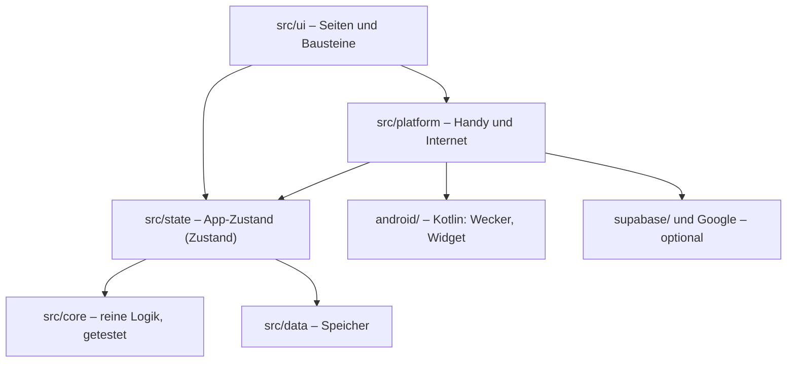

# Struktur des Repositorys

Wo liegt was, und wo änderst du was? Die Bedienung der App steht in [ANLEITUNG.md](ANLEITUNG.md), die Einrichtung der Dienste im [README](../README.md).

## Der Grundgedanke

Anker besteht aus wenigen klar getrennten Schichten. Die Pfeile zeigen, wer wen benutzt:



**Was bei einem Tipp passiert:**

1. Du tippst „Erledigt“, die Seite ruft eine Aktion im Store auf.
2. Der Store speichert lokal und vergibt XP.
3. `onPlanChange` meldet die Änderung (400 ms verzögert).
4. `platform/effects.ts` plant Erinnerungen und Wecker neu und aktualisiert das Widget.
5. Falls eingerichtet: Sync höchstens jede Minute, Kalender alle 15 Minuten.

## Oberste Ebene

| Pfad | Inhalt |
|---|---|
| `src/` | Der App-Code (Web und Android teilen ihn sich) |
| `android/` | Android-Projekt von Capacitor plus eigener Kotlin-Code |
| `supabase/` | Datenbank-Migration und Edge Function `pc-stop` |
| `e2e/` | Playwright-Smoke-Test |
| `scripts/` | `icons.mjs` (Icons erzeugen), `gradle.mjs` (Gradle unter Windows und Linux starten) |
| `public/` | App-Icons für die Web-Version |
| `docs/` | Diese Dokumente |
| `.github/workflows/` | `ci.yml` (jeder Push), `release.yml` (signierte APK bei Tag `v*`) |
| `README.md` | Einrichtung: GitHub, Supabase, Google, Netlify, Keystore, Handy, PC |
| `CLAUDE.md` | Architektur und Regeln für spätere Claude-Sessions |

Konfiguration: `app.config.ts` (Paketname), `capacitor.config.ts`, `vite.config.ts`, `netlify.toml`, `.env.example` (alle Variablen, alle optional).

Nicht im Repo, weil von `.gitignore` ausgeschlossen: `node_modules/`, `dist/`, `.env`, `android/app/build/`, Keystore und `keystore.properties`.

## `src/core/` – die Logik

Reine Funktionen ohne Seiteneffekte. Hier liegen auch die meisten Tests.

| Datei | Aufgabe |
|---|---|
| `time.ts` | Zeitrechnung für Europe/Berlin inklusive Sommerzeit |
| `types.ts` | Alle Datentypen (`Settings`, `DayLog`, `DayPlan` …) |
| `defaults.ts` | Standardwerte und Zeitvorschlag, rückwärts vom Arbeitsbeginn |
| `now.ts` | Was der Tagesplan gerade vorsieht |
| `support.ts` | `nextAction()`: wählt genau eine Handlung (Plan, Arbeit, Aufgaben, Wiedereinstieg), Modi, Fokus-Puls, „Tag neu sortieren“ |
| `alarm.ts` | Konfiguration für den nativen Wecker |
| `planner/adaptive.ts` | Wege und Termine, Konflikte, Maps-Link |
| `sleep.ts` | Späteste Weckzeit, Schlafhinweis, Weckvorschlag |
| `weather.ts` | Wetterhinweis für die Zeit draußen |
| `print.ts` | Was auf welchem Druckblatt steht |
| `planner/plan.ts` | `buildDayPlan()`: die Zeitleiste eines Tages |
| `planner/fit.ts` | Routinen ins Zeitfenster einpassen, Minimal-Versionen wählen |
| `game/themes.ts` | Die fünf Themen mit Level-Namen und Abzeichen |
| `game/xp.ts`, `awards.ts` | XP-Werte, Level, einmalige Vergabe pro Tag |
| `game/evaluate.ts` | Kernziele je Stufe, Status eines Tages |
| `game/chapter.ts` | Kapitel, Regel „Nie zweimal“, Joker |
| `game/progress.ts` | Kapitel-Abschluss, Stufen-Angebot, Erfolge |
| `reminders/build.ts` | Erinnerungen mit Slot und Rang, Zeitfenster frei wählbar |
| `export/` | `.ics`, JSON-Sicherung, PC-Stopp-Skripte |

**Zeiten:** Im Plan zählen Minuten ab lokaler Mitternacht (435 = 07:15, 1470 = 00:30 am Folgetag). In UTC wird nur an den Rändern umgerechnet: Benachrichtigungen, Kalender, Zeitstempel im Tageslog.

## `src/data/` – der Speicher

Eine gemeinsame Schnittstelle (`types.ts`) mit drei Umsetzungen: `sqlite.ts` (Android), `dexie.ts` (Browser), `memory.ts` (Tests und Notlösung). `index.ts` wählt die passende aus.

Alles liegt als gleichförmiger Datensatz vor: `{ collection, id, data, updated_at, deleted, dirty }`. Sammlungen: `settings`, `days`, `inbox`, `game`, `reviews`, `meta`. `merge.ts` enthält die Sync-Regel: Der neuere Stand gewinnt.

**`meta` wird nicht synchronisiert.** Dort liegt `local` (`LocalData`): Arbeitsaufgaben, Übergabe, Wiedereinstieg, Einnahmeprotokoll. In der JSON-Sicherung ist es enthalten, darauf weist die Sicherungsseite hin.

## `src/state/` – der App-Zustand

`store.ts` ist die einzige Stelle, die ins Repository schreibt. `hooks.ts` liefert den Seiten Uhrzeit, Plan und Tageslog.

## `src/platform/` – Handy und Internet

Alle Aufrufe von außen sind abgesichert: Fällt etwas aus, läuft der Rest weiter.

| Datei | Aufgabe |
|---|---|
| `effects.ts` | Verbindet Planänderungen mit allen Extras |
| `notifications.ts` | Übergibt Erinnerungen an den nativen Teil, trägt Knopf-Aktionen im Store nach |
| `alarm.ts` | Wecker-Konfiguration an Kotlin, Fehler landen sichtbar im Store (nicht über `safe()`) |
| `native.ts` | Brücke zum Kotlin-Plugin |
| `weather.ts` | Open-Meteo, nur wenn eingeschaltet |
| `qr.ts`, `health.ts`, `files.ts` | QR-Scan, Health Connect, Dateien speichern oder teilen |
| `supabase.ts`, `google.ts` | Sync und Login, PC-Stopp-Zeiten, Kalender |

## `src/ui/` – die Oberfläche

**`components/`**: `ui.tsx` (Button, Card, Sheet …), `Shell.tsx` (Navigation, Gedanken-Knopf, Feier-Bildschirme), `Timeline.tsx`, `Stuck.tsx`, `TodayDifferent.tsx` („Heute anders“), `DayCommitments.tsx`, `DayTasks.tsx`, `WeatherCard.tsx`, `Sortable.tsx`, `QrCode.tsx`, `SportToggle.tsx`.

**`pages/`** (die Routen stehen in `src/App.tsx`):

| Datei | Route | Inhalt |
|---|---|---|
| `Onboarding.tsx` | `/start` | Ersteinrichtung |
| `Now.tsx` | `/` | Startseite „Jetzt“ |
| `Work.tsx` | `/arbeit` | Arbeitsaufgaben, Übergabe, Vorlagen |
| `Focus.tsx` | `/fokus/:routine` | Routine Schritt für Schritt |
| `Day.tsx` | `/tag` | Tageslinie, Kernziele |
| `Game.tsx`, `Shop.tsx` | `/spiel`, `/spiel/shop` | Level, Kapitel, Erfolge, Belohnungen |
| `Inbox.tsx` | `/inbox` | Gedanken durchsehen (`/gedanke` vom Widget öffnet nur das Eingabefeld, siehe `App.tsx`) |
| `Daily.tsx` | `/essen`, `/aufraeumen`, `/vorbereitung`, `/rueckblick` | Alltag |
| `More.tsx` | `/mehr` | Menü |
| `Settings.tsx` | `/einstellungen/:section` | Alle Einstellungen |
| `Alarm.tsx` | `/wecker`, `/wecker/klingelt` | Wecker einrichten, Klingel-Bildschirm |
| `Check.tsx` | `/check` | Einrichtungs-Check |
| `PcStop.tsx` | `/pc-stopp` | PC-Stopp und Windows-Paket |
| `Connections.tsx` | `/verbindungen` | Sync, Google, `.ics` |
| `Static.tsx` | `/hilfe`, `/backup`, `/druck` | Hilfe, Sicherung, Druckansicht |

## `android/` – der native Teil

Eigener Code liegt in `app/src/main/java/de/frnkrm/anker/`:

| Datei | Aufgabe |
|---|---|
| `MainActivity.kt` | Einstieg, Anzeige über dem Sperrbildschirm beim Klingeln |
| `AnkerNativePlugin.kt` | Brücke zur Web-App, Gegenstück zu `src/platform/native.ts` |
| `AlarmModel.kt` | Reine Wecker-Logik: Alarmarten, Planung, Zustandsübergänge (JUnit) |
| `AlarmController.kt` | Einziger Besitzer des Weckerzustands, plant bei Android ein |
| `AlarmService.kt` | Klingeln im Vordergrund, Zeitlimit, Ton-Rückfallkette |
| `ReminderModel.kt` | Reine Slot- und Warteschlangenlogik (JUnit) |
| `ReminderScheduler.kt` | Stellt Erinnerungen ohne JavaScript zu, Knöpfe in Meldungen |
| `Receivers.kt` | Weckzeit erreicht; Abgleich nach Neustart, Update, Zeit- und Rechteänderung |
| `AnkerWidget.kt` | Homescreen-Widget |
| `AnkerPrefs.kt` | Kleiner Speicher für den nativen Teil |

Wichtig außerdem: `app/src/main/AndroidManifest.xml` (Berechtigungen) und `app/build.gradle` (Signierung, Versionen). Das Web-Bundle unter `app/src/main/assets/public/` wird von `cap sync` erzeugt, also nicht von Hand ändern.

## `supabase/` – optionaler Server

- `migrations/`: Tabellen `records`, `pc_stop`, `pc_stop_tokens` mit Row Level Security, dazu `upsert_records` (neuerer Stand gewinnt).
- `functions/pc-stop/`: Liefert dem PC nur die PC-Stopp-Zeit. Anmeldung über persönlichen Token.

## Wo ändere ich was?

| Ich will … | Datei |
|---|---|
| Standardwerte oder Standard-Routinen ändern | `src/core/defaults.ts` |
| Die Tagesplanung ändern | `src/core/planner/plan.ts` |
| Ändern, was die Startseite anzeigt | `src/core/now.ts`, Darstellung in `src/ui/pages/Now.tsx` |
| Ein Thema ergänzen oder umbenennen | `src/core/game/themes.ts`, neue ID auch bei `ThemeId` in `types.ts` |
| XP oder Level anpassen | `src/core/game/xp.ts` |
| Kernziele oder Stufen ändern | `src/core/game/evaluate.ts`, Anzeige in `src/ui/pages/Game.tsx` |
| Einen Erfolg ergänzen | `ACHIEVEMENTS` in `src/core/game/progress.ts` |
| Erinnerungstexte ändern | `src/core/reminders/build.ts` |
| Farben ändern | `src/index.css` |
| Eine neue Seite ergänzen | Datei in `src/ui/pages/`, Route in `src/App.tsx`, Link in `More.tsx` |
| Wecker-Regeln ändern | `android/…/AlarmModel.kt` samt Test, Anzeige in `src/ui/pages/Alarm.tsx` |
| Was als Nächstes dran ist | `src/core/support.ts` |
| Termine und Wege | `src/core/planner/adaptive.ts`, Regeln in [FLEXIBLE_PLANUNG.md](FLEXIBLE_PLANUNG.md) |
| Sichtbare Slots ändern | `slotFor` in `src/core/reminders/build.ts`, Regeln in `android/…/ReminderModel.kt` |

## Tests und Befehle

```bash
npm run dev
```
```bash
npm test
```
```bash
npm run test:e2e
```
```bash
npm run lint
```
```bash
npm run build
```
```bash
npm run android:debug
```

```bash
node scripts/gradle.mjs :app:testDebugUnitTest
```

- **Vitest** deckt `src/core/` und den Speicher ab.
- **JUnit** deckt die reine Kotlin-Logik ab: Alarmarten, Folgetag, Schlummern, Zeitumstellung, Slots, Warteschlange.
- **Playwright** prüft die wichtigsten Wege der Web-Version, auch die Druckansicht.
- **Nicht automatisch getestet:** alles, was Android tatsächlich tut (PendingIntents, Klingeln, Vollbild, Benachrichtigungen, Druckdialog), SQLite auf Android, Supabase und Google. Der Android-Build zeigt nur, dass der Code kompiliert. Handprüfung: [GERAETETEST.md](GERAETETEST.md).
