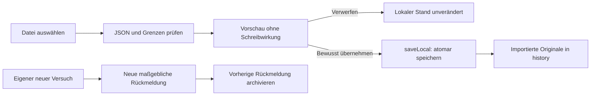

# Testberichte vor Updates sichern und wieder übernehmen

Die Testseite beginnt mit sechs freiwilligen Originalfällen: G1, G21, G62, G92, G95 und G96. Der vollständige Katalog bleibt über „Alle“ und die bisherigen Bereiche erreichbar. Der ältere Abschlusslauf G86–G95 bleibt mit zehn Stationen optional. Es wird kein Einzelfall entfernt oder automatisch als erfolgreich zusammengefasst.

## Datenvertrag

`DeviceTestProgress.reports` bleibt die maßgebliche Rückmeldung pro Test. Die optionale `history` enthält frühere Beobachtungen. Ein bewusster neuer Bericht archiviert seinen Vorgänger; „Diesen Test wieder öffnen“ archiviert den bisherigen Bericht, statt ihn zu löschen. Entwürfe bleiben getrennt.

Ein Bericht behält Ergebnis, Notiz, Zeitpunkt, Plattform, Gerät, Betriebssystem, App-Version, Build, Suite und Codestand. Nur die maßgebliche Rückmeldung zur tatsächlichen Plattform, aktuellen Suite und zum aktuellen Fingerprint kann einen aktuellen Haken setzen. Frühere und importierte Belege erscheinen prominent als „Früher geprüft“, mit eigenen Zählern und Einträgen. Der Filter „Für diesen Stand noch offen“ behält diese Belege sichtbar. „Noch nie geprüft“ bezeichnet ausschließlich Fälle ohne irgendeinen gespeicherten Beleg.

## Export und Import

Der bisherige JSON-Umschlag `{ app: "anker", exportedAt, reports }` bleibt lesbar. Neue Exporte ergänzen `history` nur bei vorhandenen früheren Belegen. Ein wiederholter Import derselben Beobachtung ist idempotent. Abweichende Ergebnisse und Metadaten bleiben getrennte Beobachtungen, auch bei gleicher Testnummer. Unbekannte zukünftige positive Testnummern bleiben gespeichert und exportierbar.

Die Dateiauswahl prüft nur und zeigt eine Vorschau. Erst die ausdrücklich beschriftete Übernahme schreibt über den bestehenden Store-Writer. Importierte Belege ergänzen grundsätzlich die Historie. Eine bestehende aktuelle Fehlermeldung bleibt deshalb auch bei einem importierten Erfolg mit gleichem Fingerprint maßgeblich. Nach Auswahl einer ungültigen Datei gibt es keine übernehmbare Vorschau und keine Teilübernahme.

Dateien sind auf 5 MiB, 10.000 Beobachtungen und 1.000 Historieneinträge pro Test begrenzt. Notizen sind auf 100.000 Zeichen, einzelne Metadaten auf 1.024 Zeichen begrenzt. Neue Texteingaben haben passende Längengrenzen. Der Export prüft auch die wieder einlesbare, eingerückte JSON-Datei und bricht bei überschrittenen Grenzen verständlich ab, ohne Daten zu kürzen. Eine vollständige Datensicherung bleibt als Weg für einen größeren Altbestand erhalten. Die Backup-Validierung akzeptiert die optionale Historie und weist ungültige Historie vor Übernahme zurück.

Während eine Rückmeldung gespeichert wird, bleiben Export und Import gesperrt. Eine Erfolgsmeldung erscheint erst nach abgeschlossener Persistenz. Export bedeutet Übergabe an Browserdownload beziehungsweise Android-Teilen; ein Versand oder eine Speicherung beim Empfänger wird dadurch nicht bestätigt. Die Datei enthält persönliche Notizen und Geräteangaben und wird nur durch den Nutzer weitergegeben.

## Nachweise und Grenzen

Coretests prüfen Altformat, vollständigen Metadatenerhalt, Archivierung, Fehlerpriorität, idempotente Übernahme, Plattformtrennung, zukünftige Testnummern, Backup-Validierung und Dateigrenzen. Dedizierte Browsertests prüfen Vorschau ohne Mutation, Abbruch, ungültige Dateien, sichtbare frühere Belege, Export/Import-Roundtrip, die sechs Originalfälle, Tastaturbedienung auf 320 px und eine echte IndexedDB-Schreibbarriere vor Export.

Diese automatischen Prüfungen bestätigen keine physische Android-Dateiauswahl, erfolgreiche Übertragung einer geteilten Datei, Zustellung, Alarmhörbarkeit oder Ergebnisse auf dem Gerät. Diese Beobachtungen bleiben eigene offene Geräteprüfungen.
