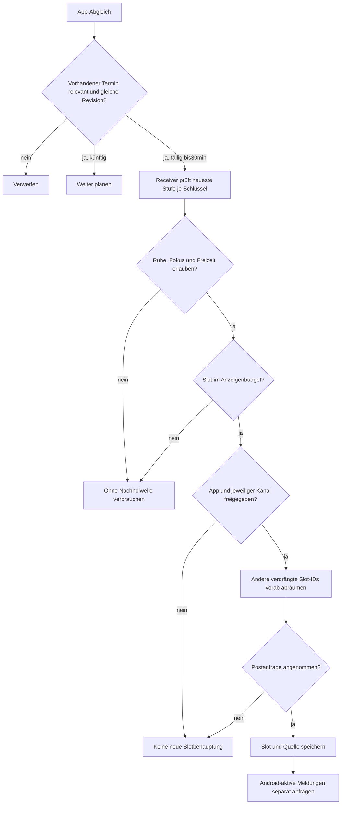

# Alltagsbenachrichtigungen: Prüfung und Korrektur,07.11.2026

Nutzerbeobachtung: Normale Alltags-Erinnerungen fehlen, obwohl der Punkt
„Benachrichtigungen“ in der Weckerdiagnose grün ist. Fehlendes Weckerklingeln
wurde nicht berichtet; die installierte Appversion und die tatsächlichen
Android-Kanalzustände sind noch nicht belegt. Die folgenden Codefehler sind
reproduziert; keiner wird ohne Gerätedaten als einzige Ursache auf dem Handy
ausgegeben.

## Belegte Fehler und minimale Korrektur

1. **Appöffnung konnte eine noch ausstehende Erinnerung löschen.**
   `ReminderLogic.replace` behielt bei jedem Synchronisieren nur zukünftige
   Einträge und zukünftige Snoozes. Eine beispielsweise eine Minute verspätete,
   unverändert relevante Erinnerung verschwand dadurch, bevor ihr Receiver
   zugestellt wurde. `takeDue` erlaubt ausdrücklich30Minuten Verspätung. Zwei
   neue Modellfälle scheiterten am unveränderten Code. Die Korrektur erhält
   vorhandene fällige Einträge bis einschließlich30Minuten nur bei weiterhin
   relevantem Schlüssel und identischer Planrevision. Entfernte/geänderte und
   ältere Termine werden nicht nachgeholt; neue vergangene Termine werden
   weiterhin nicht erfunden.
2. **Die Quellen sichtbarer Karten wurden am Kalenderdatum gelöscht.**
   `setReminderLastShown` entfernte bisher jeden anderen Tag. Eine neue Karte
   nach Mitternacht konnte damit die Quelle einer noch90Minuten gültigen
   vorherigen Karte löschen; beim nächsten Schutz-/Fokus-/Planabgleich wurde
   diese Karte als unzuordenbar abgeräumt. Quellen werden nun an die weiterhin
   gültigen Slots gebunden und bleiben über Mitternacht erhalten. Ausgediente
   Quellen werden weiter begrenzt aufgeräumt.
3. **Fehlgeschlagene Postanfragen belegten scheinbar sichtbare Slots.**
   `notify`-Fehler wurden geschluckt, trotzdem wurden Slot und Quelle gespeichert.
   Auch ein separat blockierter Kanal war vorher nicht geprüft. Nun werden
   Appfreigabe und der tatsächliche Kanal vor der Anfrage geprüft. Nur eine
   angenommene Postanfrage aktualisiert Slot und Quelle. Bekannte App-/Kanalsperren
   verdrängen keine vorhandene Karte; auch ein fehlgeschlagener Ersatz derselben
   Slot-ID lässt den Vorgänger bestehen. Andere verdrängte Slot-IDs werden vor
   dem Post abgeräumt, damit auch vorübergehend höchstens drei Anzeigen stehen.
   Entzieht Android das Recht genau nach dieser Reservierung, kann eine schon
   abgeräumte andere ID nicht sicher wiederhergestellt werden; sie wird dann
   auch nicht weiter als sichtbar gespeichert. Eine Annahme ist ausdrücklich kein
   Nachweis tatsächlicher Anzeige oder Wahrnehmung. Der sichtbare Diagnosezähler
   stammt nun aus Androids aktiven eigenen Meldungen, nicht aus gespeicherten
   Slotabsichten.

Die Erinnerungspolitik bleibt erhalten: Freizeitfenster, globale Ruhezeit,
laufender Fokus, Revisionen, Zustellungstoken, höchstens drei Anzeigen inklusive
geschützter Dienste,30Minuten Rückstaugrenze und90Minuten Kartenlebensdauer.
Verbrauchte oder während einer Sperre ausgelassene Einträge werden nicht als
spätere Benachrichtigungswelle nachgeholt. Kein Dauer-Foregrounddienst, keine
Bildschirmsteuerung, keine automatische Änderung von Android-Einstellungen.

## Additive Diagnose und gezielter Systemweg

`getAlarmDiagnostics` ergänzt optional `reminderDelivery`:

| Feld | Aussage und Grenze |
|---|---|
| `channels` | `sanft`, `uebergang`, `wecker` mit `importance` und `blocked`. `-1` bedeutet noch nicht angelegt, `0` bedeutet blockiert. Ein grüner Appschalter überschreibt diese Einzelwerte nicht. Importance1/2 kann eine sichtbare, bewusst stille Meldung erlauben. |
| `nextAt`, `nextChannel` | Nächster noch frischer oder zukünftiger gespeicherter Termin;0 bedeutet kein solcher Termin. Keine Zustellgarantie. |
| `focusUntil`, `quietUntil`, `planQuietUntil` | Ende gerade geltender Fokus-/globaler Ruhe-/Freizeitunterdrückung;0 bedeutet jeweils gerade nicht aktiv. Kritische/ausdrücklich gewählte Wege behalten ihre vorhandenen Ausnahmen. |
| `storedSlots` | Noch gültige gespeicherte Kartenabsichten. |
| `activeNotifications` | Von Android als aktiv geführte eigene normale Meldungen1001–1003; `-1` bei fehlender Auskunft. Kein Wahrnehmungs-/Tonbeleg. |
| `lastSyncAt` | Letzter erfolgreich abgeschlossener nativer Erinnerungsabgleich seit Einführung dieses Felds.0 ist bei Altständen kein Beweis, dass niemals synchronisiert wurde. |

`openReminderChannelSettings({channel})` öffnet nur für die drei erlaubten
Erinnerungskanäle den vorhandenen Android-Systempfad. Fehlende Kanäle werden mit
den bisherigen Defaults angelegt; bestehende Nutzereinstellungen bleiben
erhalten. Die App schaltet keinen Kanal selbst frei. Kotlin und
`src/platform/native.ts` verwenden denselben additiven Vertrag; alte Native-
Builds dürfen das optionale Diagnoseobjekt auslassen.

Die vorhandene Fokusspiegelung wurde geprüft: pausierte/abgelaufene Timer
spiegeln0, der native Grenzwert endet spätestens nach12Stunden. Es wurde kein
belegtes dauerhaftes Stummschalten gefunden; daher keine Änderung dieser
Regeln. Boot-/Update-/Uhr-/Rechteabgleich nutzt weiterhin denselben Receiver
und dieselbe Queue. Die14-Tage-Planung ergänzt nur wichtige zukünftige
Basisregeln und holt keine verpassten Wochen nach.

## Nachweise und offene Geräteprüfung

**63/63 reine Kotlin-/JUnit-Fälle** grün, darunter acht neue Fälle für
unverändert fällige Termine,30Minuten-Grenze/Revision, fehlgeschlagene und nur
angenommene Postanfragen, individuelle Kanalsperren,90Minuten über Mitternacht
und Ruhe-/Fokusende, fällige Snoozes und das Budget vor dem Post. Der Rotnachweis der beiden Queuefälle liegt unter
`/workspace/.cache/anker/notification-audit-tests/due-red.log`, der grüne Lauf
unter `model-green.log`. App- und Node-TypeScriptprüfung sowie gezieltes Lint
für `native.ts` erfolgreich. Die Nativeänderungen wurden außerdem isoliert
gegen Android36 kompiliert; die bestehende Vibrator-Deprecation blieb die
einzige Warnung. Vollständige Nativekompilierung/JUnit werden vor
dem Paketabschluss integriert geprüft.

Ein unabhängiger Read-only-Review prüfte Revisionen/Token, Receiver-Übergabe,
Aktionsserialisierung, Quellenbindung und Budgetreihenfolge. Ein dabei
gefundener Zwischenstand mit Post vor Abräumen einer anderen Slot-ID wurde
vor dem Commit korrigiert; der abschließende Review fand keine weiteren
konkreten neuen Fehler.

Neu gelesene Android-Primärquelle:
[NotificationManager.java](https://github.com/aosp-mirror/platform_frameworks_base/blob/1cdfff555f4a21f71ccc978290e2e212e2f8b168/core/java/android/app/NotificationManager.java),
AOSP-Spiegel Commit `1cdfff555f4a21f71ccc978290e2e212e2f8b168`.
`areNotificationsEnabled` beschreibt die Paketfreigabe; Kanal-Blockierung
entspricht `IMPORTANCE_NONE`, und `getActiveNotifications` liefert aktive
eigene Android-Meldungen. Snapshot-SHA256:
`f1dc46cf497c3d3e2a3d14c242f92dbc3da88d2fe0ee0df9a1205a4d74d83998`.

**Am echten Androidgerät offen:** installierte Version feststellen,
Kanalzustände und nächsten Termin auslesen; bewusst gewählte normale
Erinnerung mit App offen/geschlossen und Bildschirm aus beobachten; einen
einzeln blockierten Kanal bei globaler Freigabe prüfen; Ruhe/Fokus/Pause/
Timerablauf, Mitternacht, Update/Reboot und tatsächliches Android-Timeout
beobachten. Keine dieser Gerätebeobachtungen wird durch Modelltests oder eine
angenommene Postanfrage als bestanden ausgegeben.
